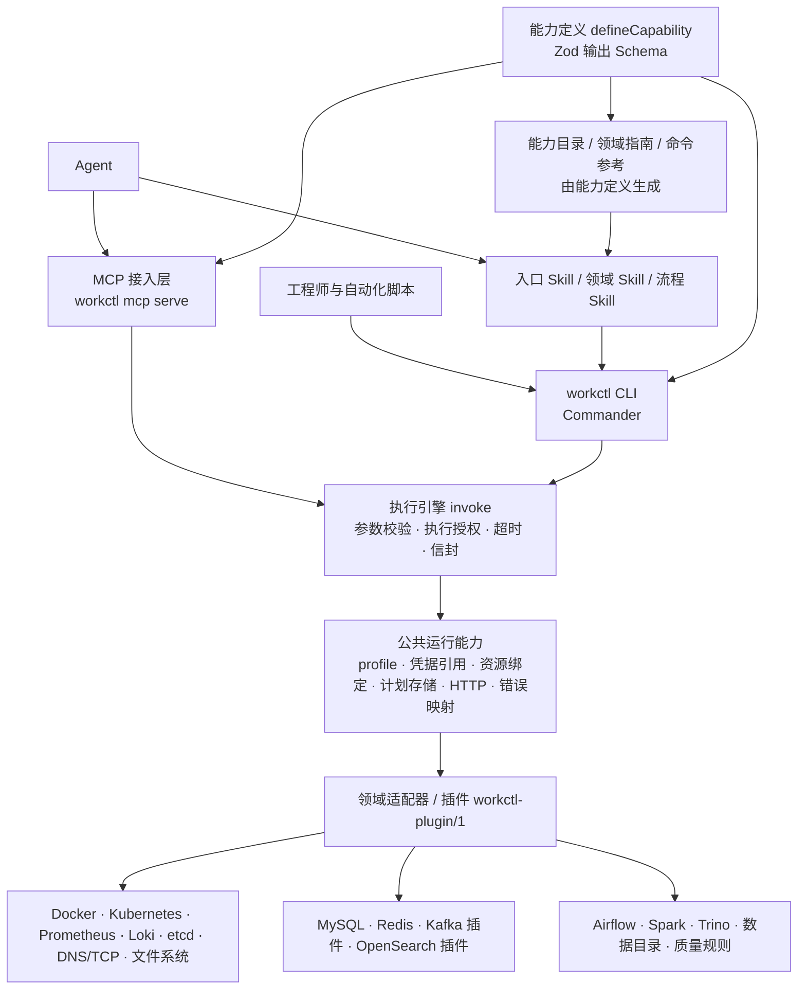

# workctl — 企业基础设施、中间件与离线链路的 Agent 能力底座

通过**统一 CLI、Skill 和文档**，把计算/容器、网络、存储、可观测、配置中心与服务发现、MySQL、Redis、消息队列、搜索引擎，以及调度、计算作业、元数据、血缘、分区产出和数据质量接入 Agent，使资源查询、运行诊断、任务分析和受控操作成为**可发现、可组合、可维护**的能力。

- **CLI**（TypeScript → esbuild 单文件 ESM，Node.js ≥ 20，npm 分发）：`workctl <domain> [resource] <action> [options]`，统一结果信封、错误码、凭据引用、时间预算。
- **Skill**（Markdown）：入口 Skill + 领域 Skill + 跨系统流程 Skill，组织领域经验与排查流程。
- **文档**：能力目录、命令参考与输出 Schema 由能力定义自动生成；领域指南写明口径、权限前置条件与已验证版本。
- **同一实现，多种消费者**：人（终端）、脚本（`--json` / 库 API）、Agent（Skill + CLI，或 MCP `workctl mcp serve`）走同一执行引擎，得到同一契约。

> 状态标注：本仓库区分 **已实现并在隔离环境验证**、**已实现未验证**、**待接入（planned）**。所有业务数据均为合成数据；没有客户环境验证结果，也不预设提效百分比。详见 [docs/compatibility.md](docs/compatibility.md) 与 [demo/evaluation.md](demo/evaluation.md)。

## 验证状态（隔离演示环境，2026-10-17）

| 项目 | 结果 | 证据 |
| --- | --- | --- |
| 单元 + 契约测试 | 469 个全部通过（`npm test`；契约测试检查：设计稿命令全覆盖、输出 Schema、指南/Skill 存在、示例命令有效、生成文档与定义一致、MCP 工具与能力一致） | `npm test` |
| 真实环境集成测试 | `WORKCTL_IT=1 WORKCTL_AF3=1 WORKCTL_K8S=1 npm test`：540/540 通过 | MySQL 8.4.11、Redis 7.4.11、Kafka 3.9.1、OpenSearch 2.19.3、etcd 3.5.21、Airflow 2.10.5 / 3.3.2、Spark 3.5.5、Trino 476、Docker 29.8.2、Prometheus 3.5.0、Loki 3.5.5、k3s v1.31.4 |
| 逐能力真实调用 | 74/74 用例通过（含插件、补数计划、隔离环境中真实执行重启并记录状态迁移、预期错误码） | [demo/verification/report.md](demo/verification/report.md) |
| 交叉审查 | 各领域（含后加入的 Kubernetes、Airflow v2、Trino、Loki）由非作者复审，修复 58 个缺陷并补回归测试（如优化器提示绕过执行时限、Spark SQL `reflect`/文件查询绕过只读防护、重启后 unhealthy 仍判成功、组合调用绕过执行授权、Airflow 3 无 logical_date 的运行导致补数重复、同标签的其他 Pod 混入工作负载） | git 历史 “Cross-review fixes” |
| Kubernetes provider | 单节点 k3s v1.31.4 上 10/10（身份探测、Pod/Deployment 状态、事件、metrics-server 快照、容量、真实滚动重启）；Docker 与 Kubernetes 两种 provider 输出通过同一 Schema | [demo/verification/report.k8s.md](demo/verification/report.k8s.md) |
| 配置中心 / 服务发现 | 内置 `config get/diff`、`discovery list` 走 etcd v3 网关：按服务绑定解析键前缀、修订号与逐键差异、敏感值遮蔽、租约与健康；etcd 3.5.21 上 16/16 | [demo/verification/report.config.md](demo/verification/report.config.md) |
| 插件补齐待接入能力 | `demo-search` 插件实现内置目录中 planned 的 `search.index.get` / `search.query`（并新增 `search.cluster.get`）：别名解析、yellow 原因、受限 DSL 白名单、部分分片失败 → `partial`；OpenSearch 2.19.3 上 19/19 | [demo/verification/report.search.md](demo/verification/report.search.md) |
| SQL 引擎 | `sql query submit/get/cancel` 对 Spark 3.5.5 与 Trino 476 输出同一契约；Trino 用例 15/15（成功、语法错误、表不存在、只读防护、真实取消） | [demo/verification/report.trino.md](demo/verification/report.trino.md) |
| 日志来源替换 | `log query` / `trace get` 在 Docker 日志与 Loki 3.5.5（Promtail 采集）间切换：同一批流量下条目、统计与调用树一致 | [demo/verification/log-provider-swap.md](demo/verification/log-provider-swap.md) |
| 环境可复位 | `demo/verify-all.sh`：`reset.sh` 清空全部容器、卷、Airflow/Spark 运行时、数据与密钥后，`up.sh` 约 35–55 秒重建（含 Trino、Loki、etcd、OpenSearch），场景重放约 2 分钟；随后各验证套件（主 74、Trino 15、配置 16、搜索插件 19、Kubernetes 10）、版本/来源替换与全量集成测试全部通过，整轮约 7 分钟（ALL CHECKS PASSED） | `demo/environment/up.sh`、`reset.sh` |
| 三种消费者同一契约 | CLI == 脚本 API == MCP（内置 Redis 能力、插件 Kafka 能力、插件实现的 `search.index.get`） | `demo/scenarios/reuse/same-contract.mjs` |
| 接口版本替换 | 同一组离线/计算能力对 Airflow 2.10.5（REST v1）与 Airflow 3.3.2（REST v2）输出同一契约，只有适配器与来源不同（`WORKCTL_IT=1 WORKCTL_AF3=1` 离线/计算测试通过） | [demo/verification/version-swap.md](demo/verification/version-swap.md) |
| Agent 宿主 | Claude Code 无头模式经 Skill + MCP 跑三条主线（只读 profile），三条均达到验收标准；另有仅 CLI 对照组 | [demo/agent-host/runs/](demo/agent-host/runs/)、[demo/evaluation.md](demo/evaluation.md) |
| 复用 | Skill × 能力矩阵、能力组合 | [docs/reuse-matrix.md](docs/reuse-matrix.md) |

没有客户环境验证；没有提效百分比（评估方法与已测数据见 [demo/evaluation.md](demo/evaluation.md)）。

## 能力全景

```bash
workctl capability list                  # 目录（含待接入）
workctl capability get --name mysql.statement.summary
```

| 板块 | 领域（命令前缀） | 首版重点 |
| --- | --- | --- |
| 基础设施 | `container` `capacity` `network` `storage` `metric` `log` `trace` `config` `discovery` `resource` `service` `operation` `auth` `access` | Docker 与 Kubernetes（k3s v1.31.4 实测）工作负载状态/事件/资源、资源绑定与依赖、Prometheus 指标、容器日志或 Loki、日志派生调用链、etcd 配置与服务发现、重启操作计划与执行 |
| 中间件 | `mysql` `redis` `mq`（插件） `search`（插件） | MySQL 库表/索引/会话/锁/语句采样差分/慢日志/执行计划/受限查询/索引计划；Redis 运行信息/窗口采样/慢日志/Key 元数据/SCAN 采样/LFU 热度；Kafka 主题与消费组 lag；OpenSearch 集群/索引/受限查询 |
| 离线链路 | `offline` `compute` `sql` `data` | Airflow 2.x（REST v1）与 3.x（REST v2）工作流/实例/依赖/日志/补数计划与执行、Spark 作业/Stage/日志、Airflow 资源池、Spark SQL 与 Trino 查询提交、数据目录/分区/血缘/质量规则/时效 |
| 待接入 | `document` `kv` `analytics` `middleware` `object` `hdfs` `quota`，以及已有领域内的条目（如 `mysql replication get`、`redis cluster get`、`compute yarn-queue get`） | 只出现在目录中（`status: planned`），不生成可调用命令；插件可以实现它们（见 `search`） |

完整列表：[docs/capability-catalog.md](docs/capability-catalog.md) · 参数与输出：[docs/command-reference.md](docs/command-reference.md)

## 架构



## 快速开始

```bash
npm ci && npm run build                   # 产出 dist/workctl.js（单文件）
cd demo/environment && ./up.sh && cd -    # 隔离演示环境（Docker + Airflow + Spark）
export WORKCTL_CONFIG=$PWD/demo/environment/workctl.yaml
node dist/workctl.js doctor
node dist/workctl.js --json service dependency list --service demo-order --env sandbox
node dist/workctl.js --json mysql statement summary --instance demo-mysql --sample-window 10s --timeout 30s
node dist/workctl.js --json offline run get --id <run_id> --workflow demo-daily-orders
```

详见 [docs/quickstart.md](docs/quickstart.md)、[demo/walkthrough.md](demo/walkthrough.md)。

## 结果契约

```json
{
  "schema_version": "1.0",
  "status": "success | partial | error",
  "capability": "offline.run.get",
  "data": { "scheduler_state": "success", "compute_state": "success", "output_state": "missing", "quality_state": "not_run" },
  "error": null,
  "meta": {
    "sources": [{ "system": "airflow", "adapter": "airflow-rest-v1", "method": "GET /api/v1/dags/{id}/dagRuns/{run}", "version": "2.10.5", "observed_at": "...", "relation": "explicit" }],
    "coverage": { "complete": true, "window": { "start": "...", "end": "..." } },
    "warnings": []
  },
  "context": { "request_id": "req-...", "profile": "demo", "env": "sandbox", "data_mode": "live", "capability_version": "1.0.0", "adapter": "...", "operation": "read" }
}
```

空结果、无权限（`PERMISSION_DENIED`）、未采集（`COLLECTION_DISABLED`）、部分结果（`status: partial`）、任务执行中（`data.state`）分别表达；退出码见 `workctl --help`。

## 仓库结构

```text
src/core/          能力注册、执行引擎、信封与错误码、profile 与凭据引用、资源绑定、计划存储、HTTP、插件加载
src/domains/       领域适配器：container network storage observability config mysql redis offline compute sql data (+ planned)
src/cli/           Commander 命令树（由能力定义生成）、文档生成、Skill 分发
src/mcp/           MCP stdio 服务（同一能力目录与引擎）
plugins/demo-mq/   消息队列插件（Kafka）：演示新系统通过插件机制接入
plugins/demo-search/ 搜索引擎插件（OpenSearch）：演示插件实现内置目录中“待接入”的能力
skills/            入口 / 领域 / 流程 Skill（Markdown）
docs/              目录与命令参考（生成）、Schema（生成）、领域指南、资源模型、接入与兼容说明
demo/              隔离演示环境、样例服务、离线工作流、合成数据、质量规则、场景脚本、演示与评估说明
test/              单元测试、契约测试；WORKCTL_IT=1 时运行真实环境集成测试
```

## 开发

```bash
npm run typecheck && npm run build && npm test     # 单元 + 契约测试
WORKCTL_IT=1 npm test                              # 需要演示环境
npm run docs                                       # 重新生成 docs/ 下的目录、参考与 Schema
```

新增系统见 [docs/provider-onboarding.md](docs/provider-onboarding.md)；设计约束见 [docs/design-principles.md](docs/design-principles.md)。
