# workctl 实测截图教程

这份教程按“目标 → 命令 → 截图 → 怎么读”逐步演示 `workctl` 的只读用法。每张截图都是在隔离演示环境中真实运行命令得到的输出，业务数据全部为合成数据。截图由 [`scripts/tutorial-screenshots.mjs`](../../scripts/tutorial-screenshots.mjs) 生成；每张图旁边有同名 `.txt`，保存完整的原始输出，可以直接复制命令或对照截图中省略的部分。

阅读前先了解几点：

- **采集时间与环境**：2026-10-17 约 16:20 UTC（编号 41–50 的截图约 16:36 UTC），演示环境由 `demo/environment/up.sh` 启动（另含 k3s、Airflow 3、PostgreSQL、Jenkins、Nacos、Consul）。同一环境里当时还有其他测试在跑，例如 k3s 上的滚动重启、etcd 重新灌数，所以截图中的时间戳、修订号、计数等只代表截图那一刻。重新生成后数值会不同，字段和语义不变。
- **命令写法**：截图里的 `workctl` 就是 `node dist/workctl.js`，生成器把它定义成了 shell 函数。窗口右上角标出这一步用的 `WORKCTL_CONFIG`。默认是 `demo/environment/workctl.yaml`（profile `demo`，`allow_execute=true`）；受控操作和 MCP 两节改用只读 profile `demo/environment/workctl.agent.yaml`（`allow_execute: false`）。
- **截断**：输出较长时，截图里会折叠成灰色的 `… N lines omitted` 标记，完整内容见同名 `.txt`。折叠用的是生成器的行数和顶层键规则，CLI 本身不做裁剪。
- **颜色**：CLI 不输出 ANSI 颜色。截图中键名、`#` 注释行、错误行和部分状态值的颜色，是截图脚本按 YAML/JSON 语法加上的。
- **只读**：教程里没有执行任何变更。“生成计划”类命令（重启、补数、回滚）只会在本地计划存储（profile 的 `state_dir`）里写一条计划；执行只演示“被拒绝”。第 12 节在后台运行 PostgreSQL 场景脚本的 `load` 模式，它只发两条 SELECT。

准备工作见 [demo/walkthrough.md](../../demo/walkthrough.md) §0：`npm ci && npm run build`，`cd demo/environment && ./up.sh`，再运行场景脚本（离线场景、MQ 积压、配置中心与搜索的数据，见 `demo/scenarios/*/README.md`；Jenkins 构建由 `demo/scenarios/deploy/seed-jenkins.mjs` 生成，Nacos / Consul 数据由 `demo/scenarios/config/seed-nacos.mjs`、`seed-consul.mjs` 生成）。

---

## 1. 安装与自检

**目标**：确认 CLI 可运行，并检查配置、凭据引用、端点和插件。

```bash
node dist/workctl.js --version
workctl doctor
```

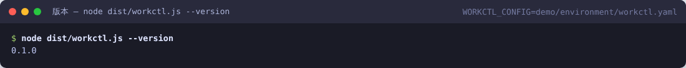

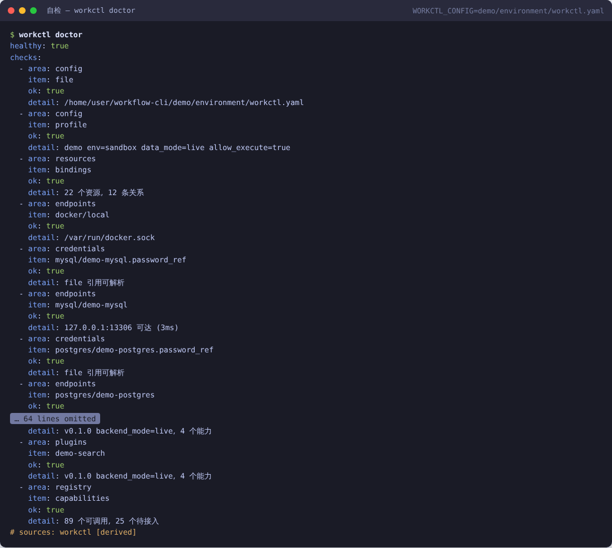

**怎么读**

- `--version` 输出 `0.1.0`。
- `healthy: true` 是总体结论；`checks` 每一项都有 `area` / `item` / `ok` / `detail`。
- `config/profile` 一项显示 `demo env=sandbox data_mode=live allow_execute=true`，即当前 profile、环境、数据模式和是否允许执行。
- 凭据只检查引用：`mysql/demo-mysql.password_ref` 和 `postgres/demo-postgres.password_ref` 的 detail 都是 `file 引用可解析`，不会打印值。端点项给出地址和连通耗时，例如 `127.0.0.1:13306 可达 (3ms)`。
- 末尾是插件（`demo-search v0.1.0 backend_mode=live，4 个能力`）和能力注册统计（`89 个可调用，25 个待接入`）。
- 最后一行 `# sources: workctl [derived]` 表示这些结论由 workctl 自己推导得出，不来自外部系统。

---

## 2. 能力发现

**目标**：不读源码，只靠目录、能力定义和帮助弄清楚有哪些能力、各自怎么用。

```bash
workctl capability list --domain redis
workctl capability get --name mysql.statement.summary
workctl redis stats sample --help
```

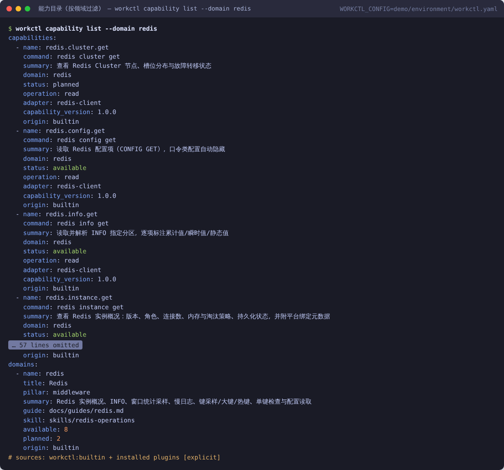

**怎么读**：每个能力列出 `name`、`command`、`status`、`operation`、`adapter`、`origin`。`redis.cluster.get` 是 `status: planned`（待接入），目录里有，但不生成可调用命令；`redis.config.get`、`redis.info.get` 是 `available`。底部 `domains` 汇总该领域 `available: 8`、`planned: 2`，并给出指南 `docs/guides/redis.md` 和 Skill `skills/redis-operations`。

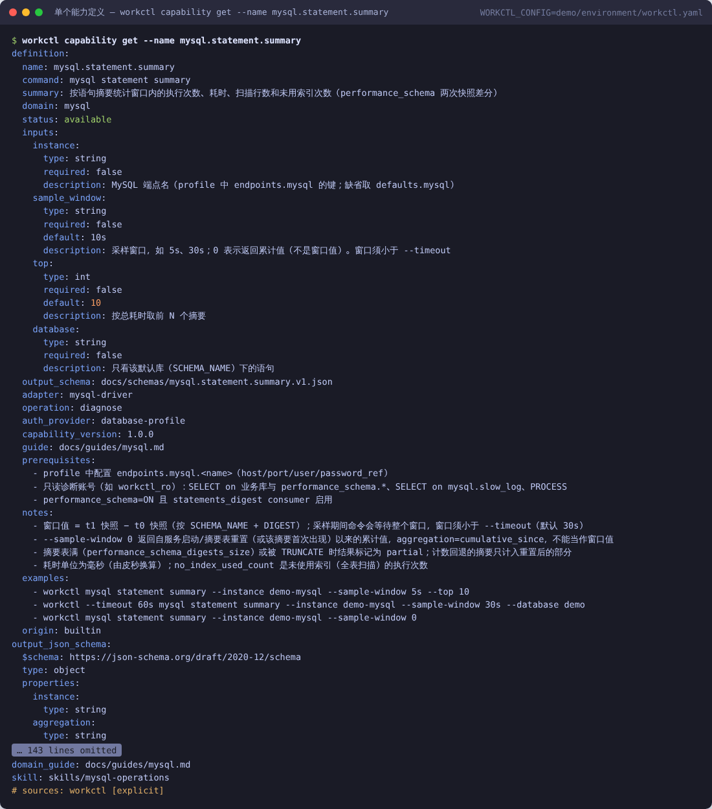

**怎么读**：`definition.inputs` 列出每个参数的类型、默认值和说明。例如 `sample_window` 的默认值是 `10s`，说明里写着“0 表示返回累计值（不是窗口值）”。`operation: diagnose` 和 `auth_provider: database-profile` 说明能力类型与认证方式。`prerequisites` 写的是账号权限前提，`notes` 写的是口径：窗口值 = t1 快照 − t0 快照，`--sample-window 0` 返回累计值。`output_json_schema` 就是输出 Schema（截图中折叠了 143 行）。

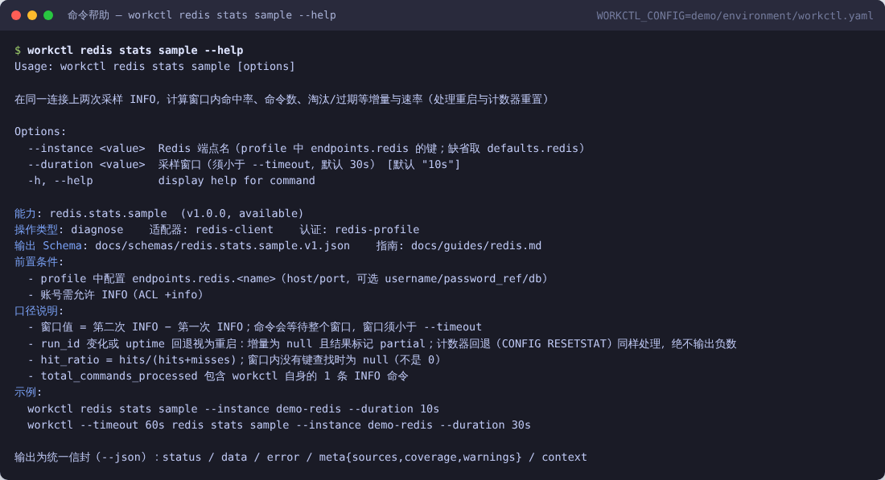

**怎么读**：`--help` 除了参数，还给出能力名与版本（`redis.stats.sample (v1.0.0, available)`）、操作类型、Schema 路径、前置条件、口径说明和示例。帮助文本和上面的能力定义来自同一份定义。

---

## 3. 统一结果信封

**目标**：看清每个结果都有的信封字段，以及错误怎么表达。

```bash
workctl --json network connectivity check --target 127.0.0.1:13306
workctl --json mysql query execute --instance demo-mysql --database demo --sql "SELECT user, host FROM mysql.user"; echo "exit=$?"
```

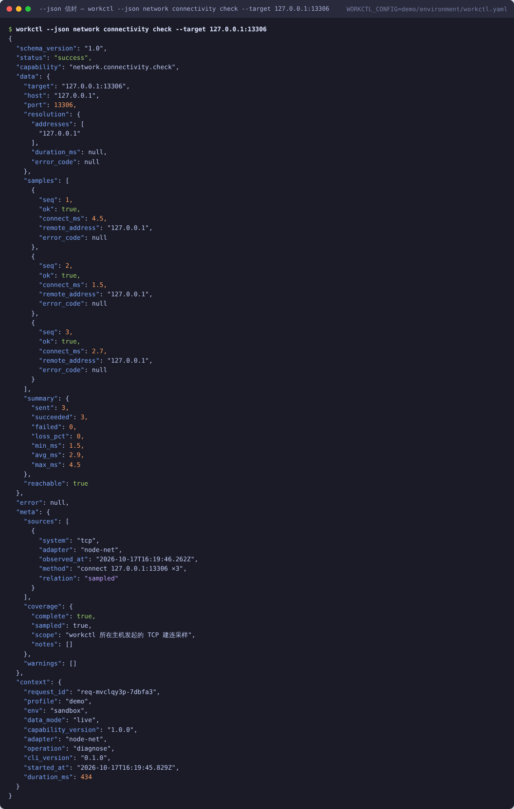

**怎么读**

- 顶层固定有 `schema_version`、`status`（这里是 `success`）、`capability`、`data`、`error`、`meta`、`context`。
- `data.samples` 是 3 次真实 TCP 建连，`summary` 汇总出 `loss_pct: 0`、`avg_ms`。
- `meta.sources[0]` 是 `system: tcp`、`method: connect 127.0.0.1:13306 ×3`、`relation: sampled`，说明结果来自采样，不是外部系统明确给出的事实。
- `meta.coverage` 有 `complete: true`、`sampled: true`，`scope` 写明是“workctl 所在主机发起的 TCP 建连采样”。
- `context` 有 `request_id`、`profile`、`data_mode: live`、`adapter: node-net`、`operation: diagnose`、`duration_ms`。

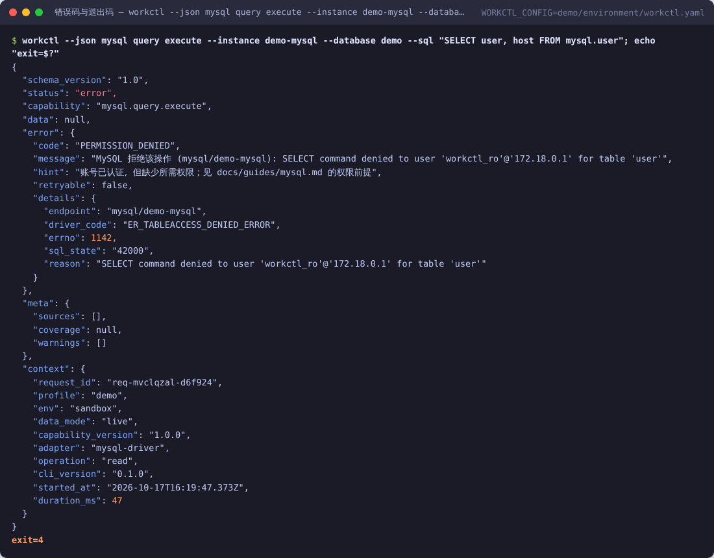

**怎么读**：只读账号 `workctl_ro` 查询 `mysql.user` 被 MySQL 拒绝，结果是 `status: error`、`data: null`，`error.code: PERMISSION_DENIED`。`error.details` 保留了驱动的原始信息（`ER_TABLEACCESS_DENIED_ERROR`、`errno: 1142`），`hint` 指向权限说明。这里的“无权限”和“空结果”是两回事。进程退出码是 `exit=4`，对应 `workctl --help` 里“4 权限”的约定。

---

## 4. 主线 A：基础设施资源与运行状态

**目标**：找到 demo-order 依赖哪些资源，看它的容器状态、指标和日志。

```bash
workctl service dependency list --service demo-order --env sandbox
workctl container workload get --service demo-order --env sandbox
workctl metric query --resource demo-order --metric request_rate --window 1h --step 5m
workctl log query --service demo-order --env sandbox --window 6h --contains "cache mode changed" --limit 2
```

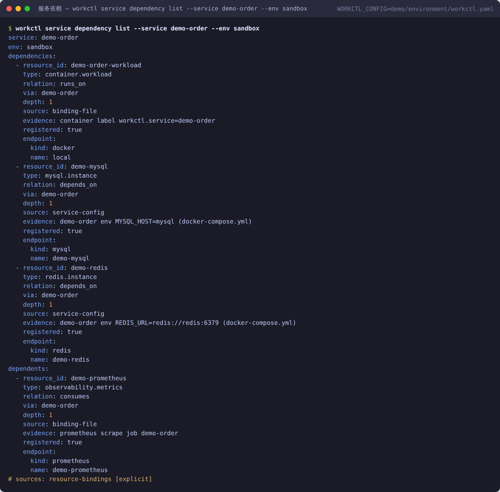

**怎么读**：`dependencies` 有 3 条：`demo-order-workload`（`runs_on`）、`demo-mysql`、`demo-redis`（`depends_on`）。每条都带 `source` 和 `evidence`，例如 MySQL 的依据是 `demo-order env MYSQL_HOST=mysql (docker-compose.yml)`，来源 `service-config`。`dependents` 里是 `demo-prometheus`（`consumes`，依据是 scrape job）。

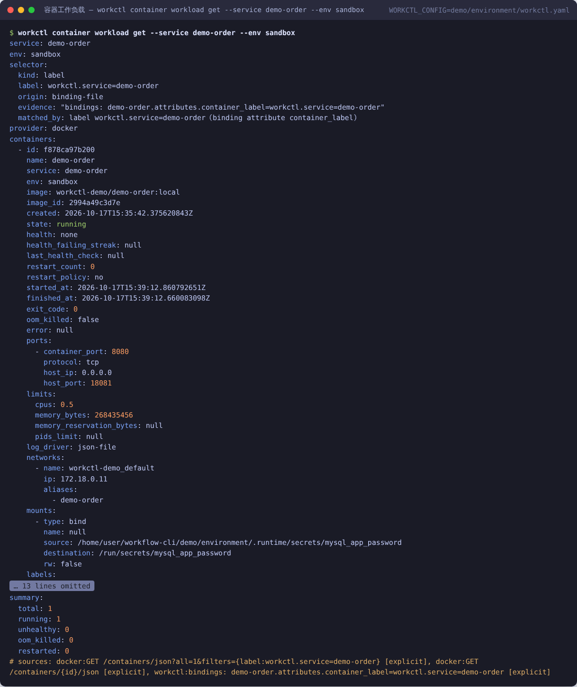

**怎么读**：`selector` 说明容器是怎么匹配到的（`label workctl.service=demo-order`，来自绑定文件）。`provider: docker`。容器字段里有 `state: running`、`health: none`（容器没有配置健康检查）、`restart_count: 0`、`oom_killed: false`、`limits.cpus: 0.5` 和 `memory_bytes: 268435456`（256 MiB）。`summary` 汇总为 `total: 1`、`running: 1`、`unhealthy: 0`。`# sources` 列出调用过的 Docker API。

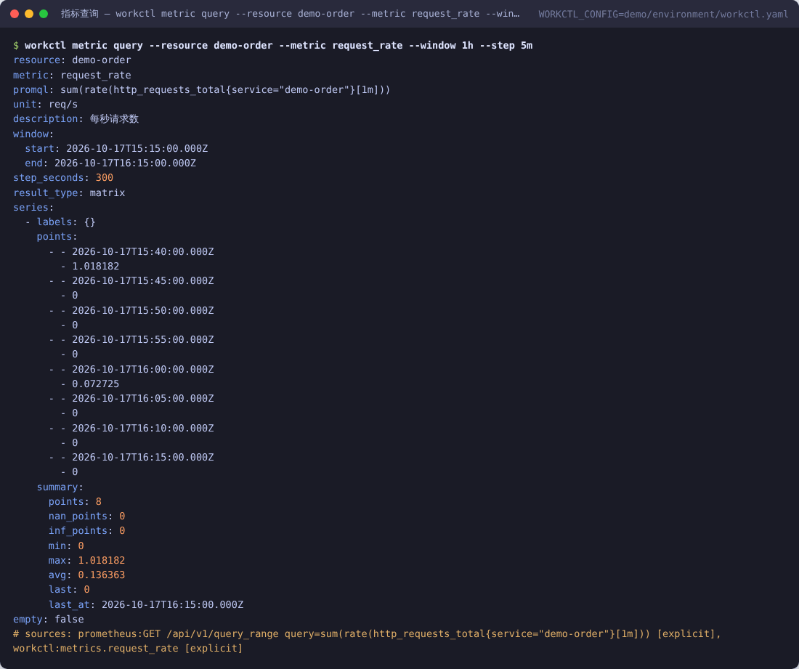

**怎么读**：输出给出实际执行的 `promql`、`unit: req/s` 和查询窗口。窗口从 15:15 开始，但第一个数据点是 15:40，Prometheus 在那之前没有这个序列的数据。之后的点大多是 0，说明截图时没有持续负载。`summary` 给出 `points: 8`、`min: 0`、`max: 1.018182`、`avg: 0.136363`、`last: 0`。`empty: false` 表示有数据点，即使值是 0。

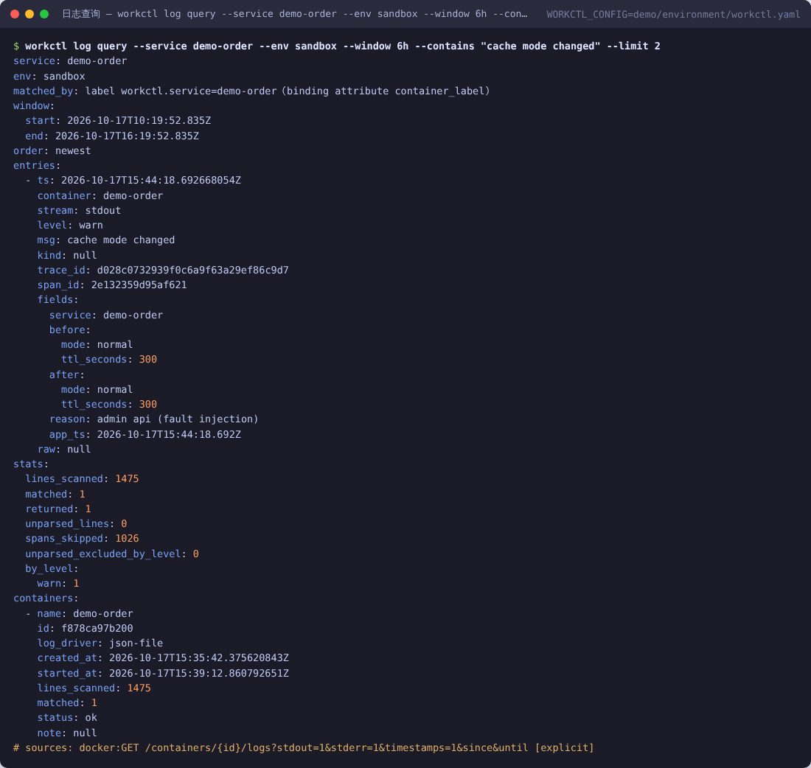

**怎么读**：命中 1 条 `level: warn`、`msg: cache mode changed`，`fields.reason: admin api (fault injection)`，并带 `trace_id`，可以继续用 `trace get` 追踪。`stats` 显示扫描了 1475 行、命中 1 行，`spans_skipped: 1026`（调用链 span 行不算日志）。`containers[].log_driver: json-file` 和 `# sources: docker:GET /containers/{id}/logs…` 说明日志来自 Docker。

---

## 5. 主线 B：中间件（MySQL、Redis、Kafka 插件）

**目标**：区分窗口值和累计值，区分估计和实测，看采样覆盖范围和插件能力。

```bash
workctl --timeout 30s mysql statement summary --instance demo-mysql --sample-window 10s --top 3
workctl mysql statement summary --instance demo-mysql --sample-window 0 --top 2 --database demo
workctl mysql query explain --instance demo-mysql --database demo --sql-file demo/scenarios/latency/customer_recent.sql
```

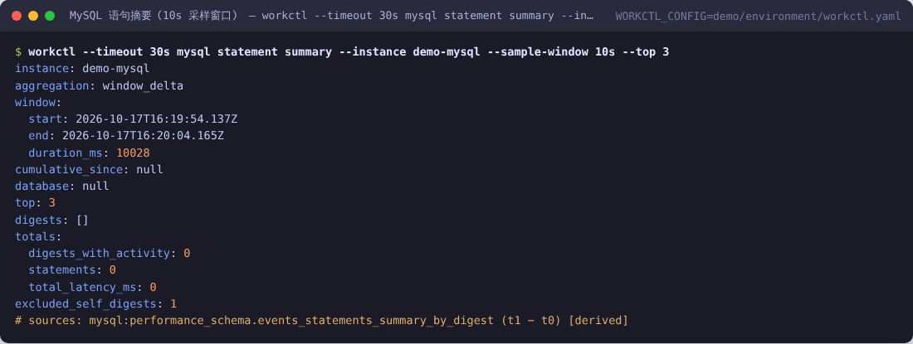

**怎么读**：`aggregation: window_delta`，窗口约 10 秒（`duration_ms: 10028`）。截图时没有业务流量，所以 `digests: []`、`totals.statements: 0`。这是“窗口内为空”，不是错误。`excluded_self_digests: 1` 表示 workctl 自己的采样语句已被排除。来源标为 `(t1 − t0) [derived]`。

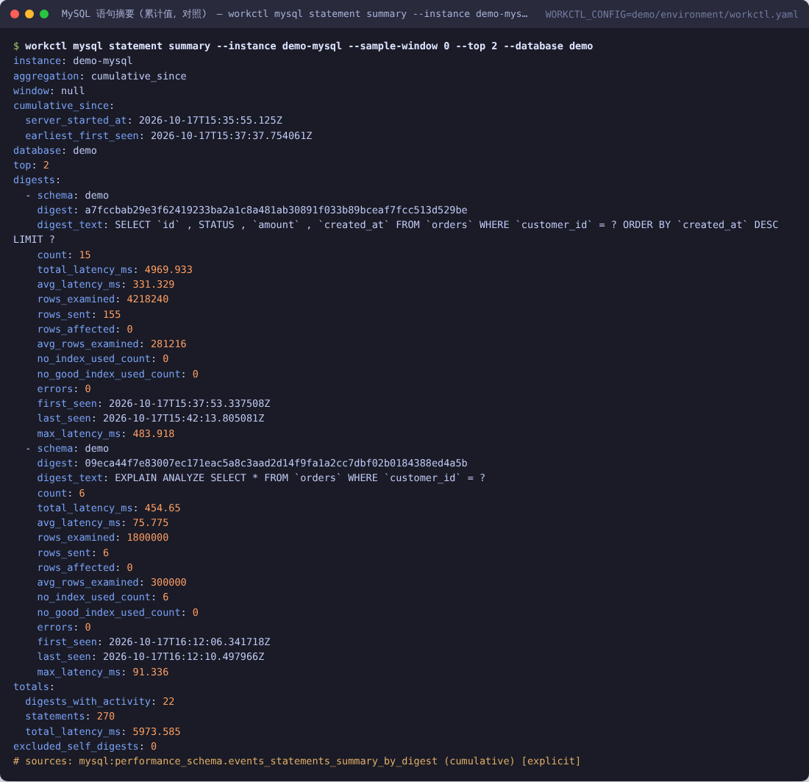

**怎么读**：同一能力用 `--sample-window 0` 时，`aggregation: cumulative_since`、`window: null`，并给出 `cumulative_since.server_started_at`。这是自服务启动以来的累计值，不能当作窗口值。第一条摘要是演示场景里的慢查询 `… WHERE customer_id = ? ORDER BY created_at DESC LIMIT ?`：`count: 15`、`avg_latency_ms: 331.329`、`avg_rows_examined: 281216`。来源标为 `(cumulative) [explicit]`。

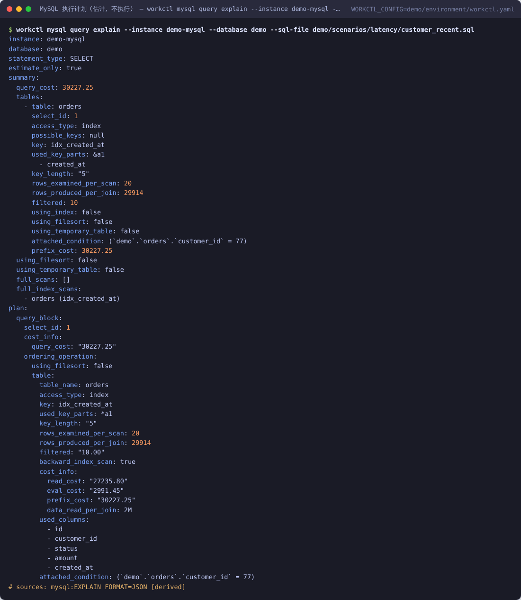

**怎么读**：`estimate_only: true` 表示 EXPLAIN 只给优化器估计，不执行语句。`summary.tables[0]` 中 `access_type: index`、`key: idx_created_at`、`possible_keys: null`、`attached_condition: customer_id = 77`。`full_index_scans` 列出 `orders (idx_created_at)`：语句沿 `created_at` 索引倒序扫描，再逐行过滤 `customer_id`，没有可用于 `customer_id` 的索引。`plan` 是 `EXPLAIN FORMAT=JSON` 的原始结构。

```bash
workctl --timeout 30s redis stats sample --instance demo-redis --duration 5s
workctl redis key sample --instance demo-redis --pattern 'demo:*' --max-keys 20
workctl mq consumer lag --cluster demo-mq --group demo-consumer
```

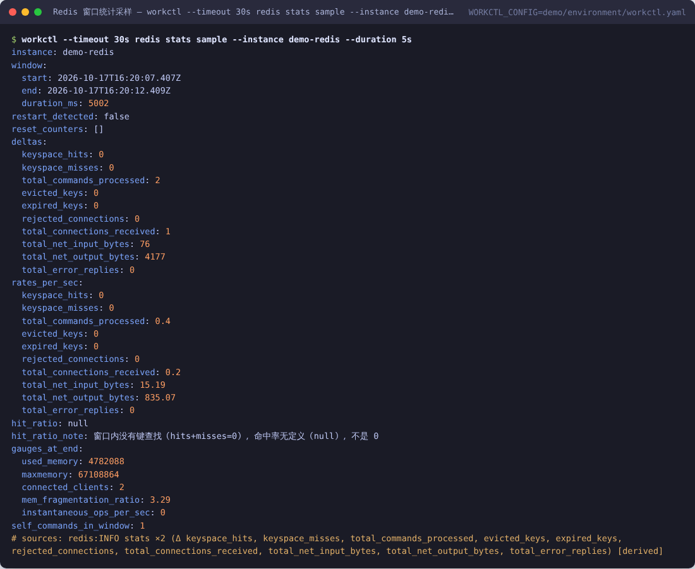

**怎么读**：`deltas` 和 `rates_per_sec` 是 5 秒窗口内的增量和速率，`restart_detected: false`。截图时窗口内 `keyspace_hits` 和 `keyspace_misses` 都是 0，所以 `hit_ratio: null`。`hit_ratio_note` 写明“命中率无定义（null），不是 0”。`self_commands_in_window: 1` 是 workctl 自己发出的 INFO。`gauges_at_end` 是窗口结束时的瞬时值。

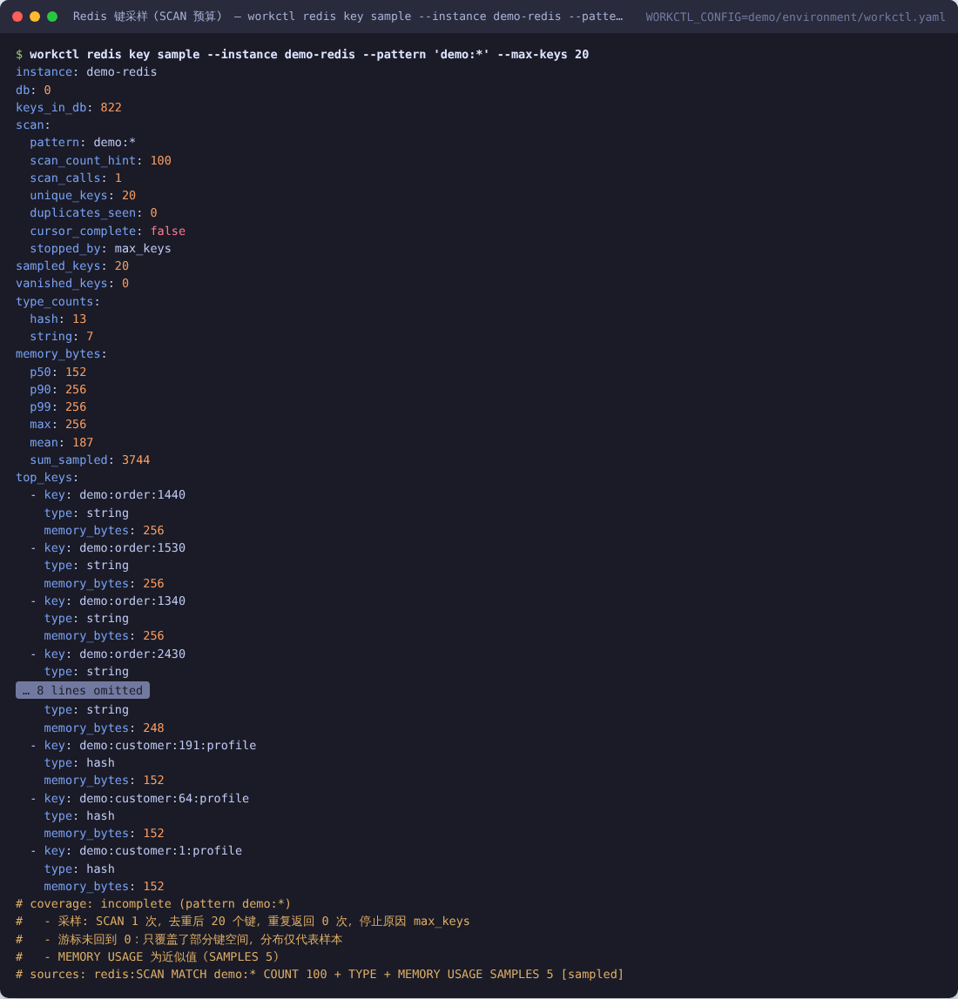

**怎么读**：`scan` 中 `stopped_by: max_keys`、`cursor_complete: false`，说明只扫了部分键空间（库中 `keys_in_db` 远多于样本的 20 个）。`memory_bytes` 的分位数只代表样本。`# coverage: incomplete` 下的注释说明了采样次数、停止原因，以及 MEMORY USAGE 是近似值。来源 `relation` 为 `sampled`。

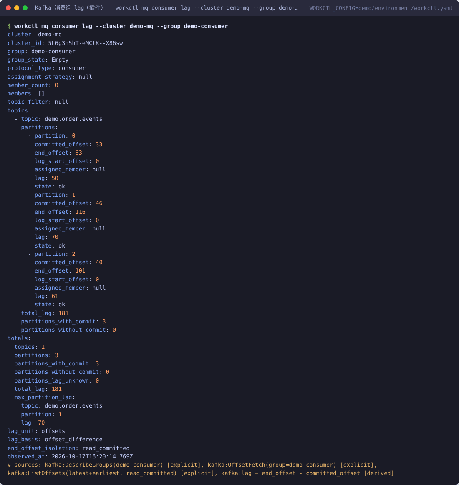

**怎么读**：这个能力由 `demo-mq` 插件提供。消费组 `group_state: Empty`、`member_count: 0`，即当前没有消费者在线。每个分区给出 `committed_offset`、`end_offset` 和 `lag`（50 / 70 / 61），合计 `total_lag: 181`，`max_partition_lag` 在 partition 1。`lag_unit: offsets`、`lag_basis: offset_difference` 说明 lag 是位点差，不是时间。`# sources` 中最后一项 `lag = end_offset - committed_offset [derived]` 标明这是推导值。

---

## 6. 主线 C：离线产出与补数计划

**目标**：从业务日期找到运行，分层确认“调度成功”是否真的产出了数据，再生成补数计划。

```bash
workctl offline run list --workflow demo-daily-orders --data-date 2026-10-16 --timezone Asia/Shanghai
workctl --timeout 60s offline run get --id demo__2026-10-16__wrong_partition --workflow demo-daily-orders
workctl --timeout 60s offline backfill plan --workflow demo-daily-orders --from 2026-10-14 --to 2026-10-16 --timezone Asia/Shanghai
workctl data partition get --catalog demo --table analytics.daily_orders --partition dt=2026-10-16
```

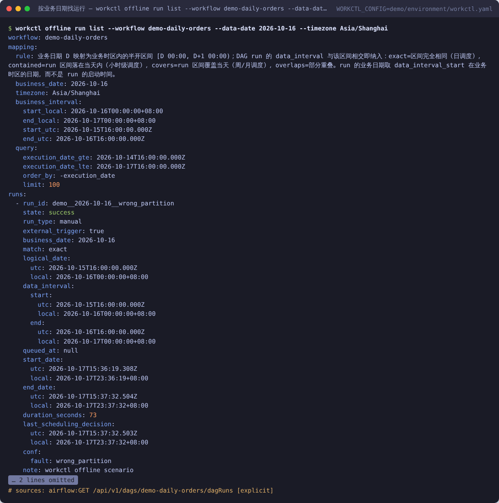

**怎么读**：`mapping.rule` 写明业务日期如何映射到数据区间（Asia/Shanghai 自然日，半开区间）。`business_interval` 给出本地时间和 UTC 两种写法。`runs` 中找到 `demo__2026-10-16__wrong_partition`，`state: success`、`match: exact`，`conf.fault: wrong_partition` 是场景注入的标记。

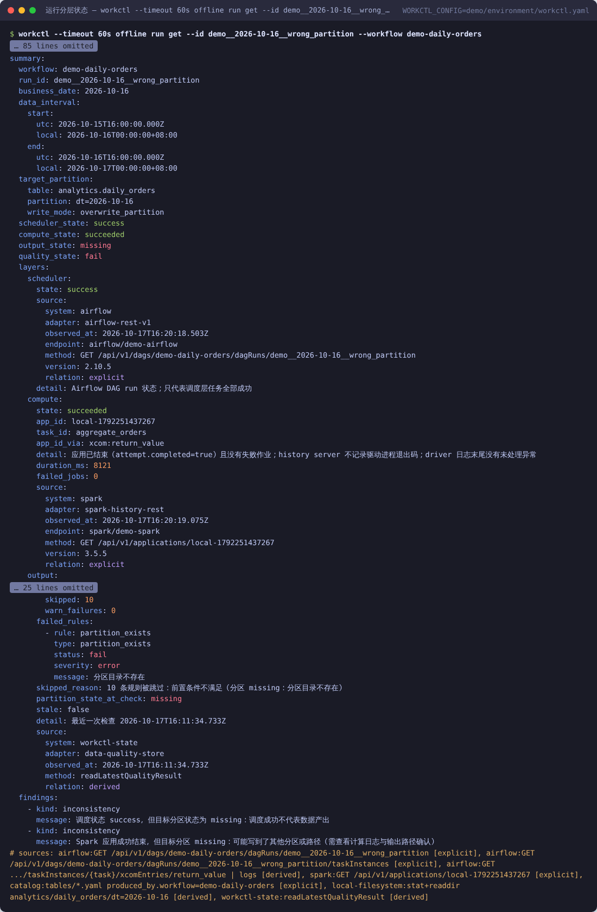

**怎么读**（截图只保留 `summary` 块）：

- `target_partition` 是 `analytics.daily_orders` 的 `dt=2026-10-16`，`write_mode: overwrite_partition`。
- 四层状态分别是 `scheduler_state: success`、`compute_state: succeeded`、`output_state: missing`、`quality_state: fail`。
- `layers` 中每层都有自己的 `source`。调度层来自 Airflow `adapter: airflow-rest-v1`、`version: 2.10.5`；计算层来自 Spark history `version: 3.5.5`，并给出 `app_id`。这两层都是 `relation: explicit`。
- 质量层中 `failed_rules` 只有 `partition_exists` 失败；`skipped_reason` 说明其余 10 条规则因为分区 missing 被跳过。来源是 `workctl-state`，`relation: derived`。产出层的细节被折叠了，但它的来源出现在最后的 `# sources` 行：`local-filesystem:stat+readdir … [derived]`。
- 末尾的 `findings` 给出两条 `inconsistency`：调度成功但目标分区 missing；Spark 成功结束但目标分区 missing，可能写到了其他分区。

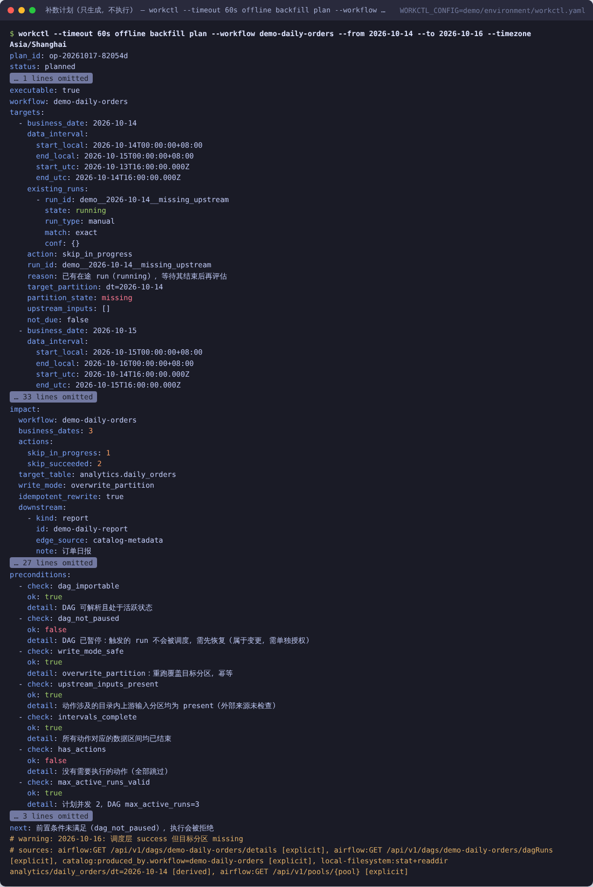

**怎么读**

- 计划 `status: planned`，命令只生成计划，没有触发任何 run。
- `targets` 按业务日期列出动作。例如 10-14 的 `action: skip_in_progress`，因为已有 `running` 的 run；同时给出 `partition_state: missing`。
- `impact` 汇总 3 个业务日期（`skip_in_progress: 1`、`skip_succeeded: 2`），以及 `write_mode: overwrite_partition`、`idempotent_rewrite: true` 和下游报表 `demo-daily-report`。
- `preconditions` 中 `dag_not_paused` 为 `ok: false`（演示 DAG 被暂停以冻结场景），`has_actions` 也是 `false`；`next` 写明“前置条件未满足（dag_not_paused），执行会被拒绝”。
- `# warning: 2026-10-16: 调度层 success 但目标分区 missing` 提醒：10-16 虽然被判为 `skip_succeeded`，但数据并没有产出。

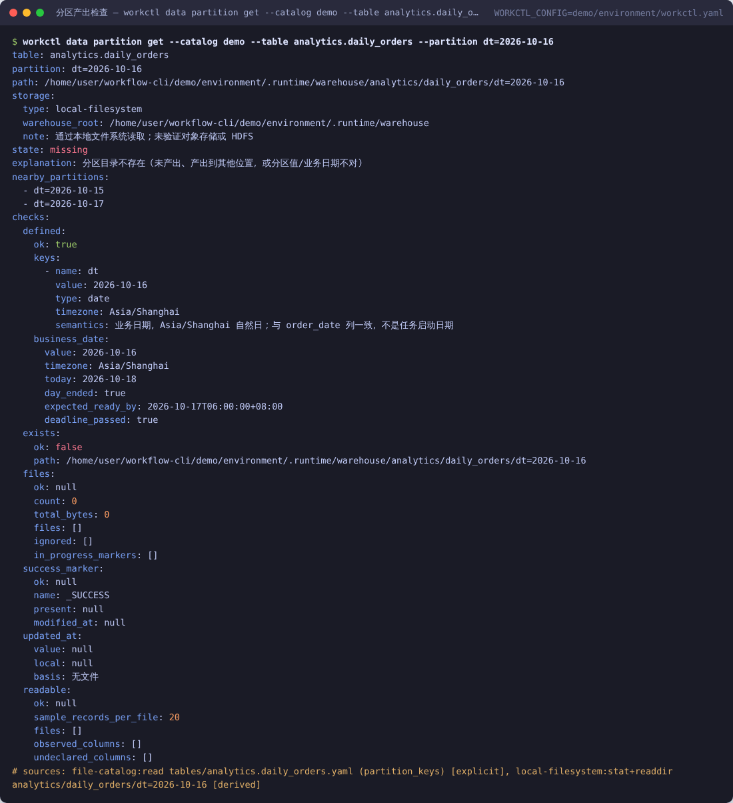

**怎么读**：`state: missing`，`explanation` 列出可能原因。`nearby_partitions` 中有 `dt=2026-10-15` 和 `dt=2026-10-17`，可以对照错误分区这个场景。`checks.defined` 说明分区键 `dt` 的语义（业务日期，Asia/Shanghai），`business_date.deadline_passed: true`。`exists.ok: false` 之后的检查项（`files`、`success_marker`、`readable`）都是 `ok: null`，表示没有执行，而不是失败。`storage.note` 写明只验证了本地文件系统。

---

## 7. 配置中心与服务发现（etcd / Nacos / Consul）

**目标**：读取服务配置（敏感值遮蔽），对比修订间的差异，查看注册实例和租约。同一组命令按资源绑定选择 etcd、Nacos 或 Consul。

### 7.1 etcd（demo-order）

```bash
workctl config get --service demo-order --env sandbox
workctl config diff --service demo-order --key cache.ttl_seconds
workctl discovery list --service demo-order
```

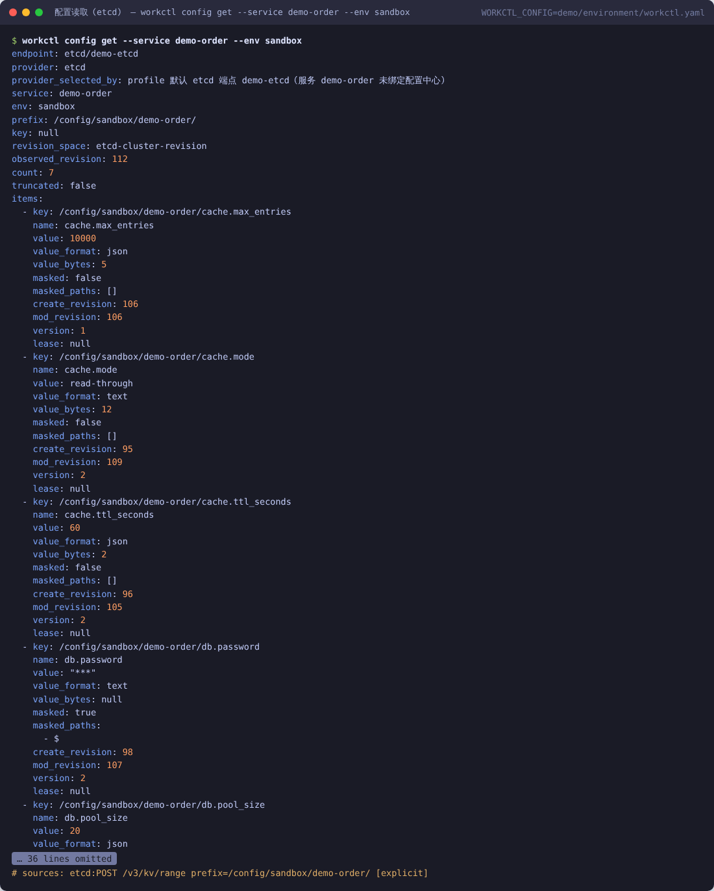

**怎么读**：`provider_selected_by` 说明为什么选了 etcd：demo-order 没有绑定配置中心，于是用 profile 默认端点。每个配置项给出 `value`、`create_revision` / `mod_revision` / `version`。`db.password` 一项 `masked: true`，值被遮蔽。`observed_revision` 是读取时 etcd 的集群修订号。

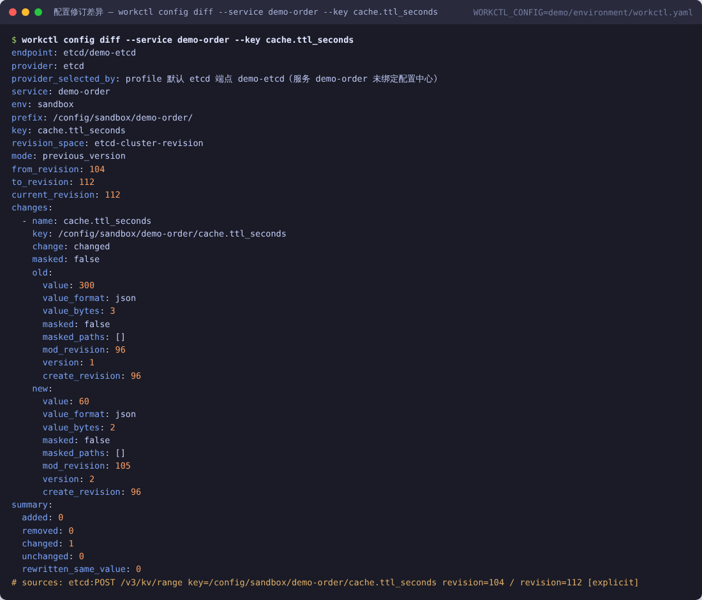

**怎么读**：`mode: previous_version`，对比 `from_revision` 与 `to_revision`。`changes[0]` 中 `cache.ttl_seconds` 从 `300` 变为 `60`（`change: changed`），新旧两侧都带 `mod_revision` 和 `version`。`summary` 显示 `changed: 1`。

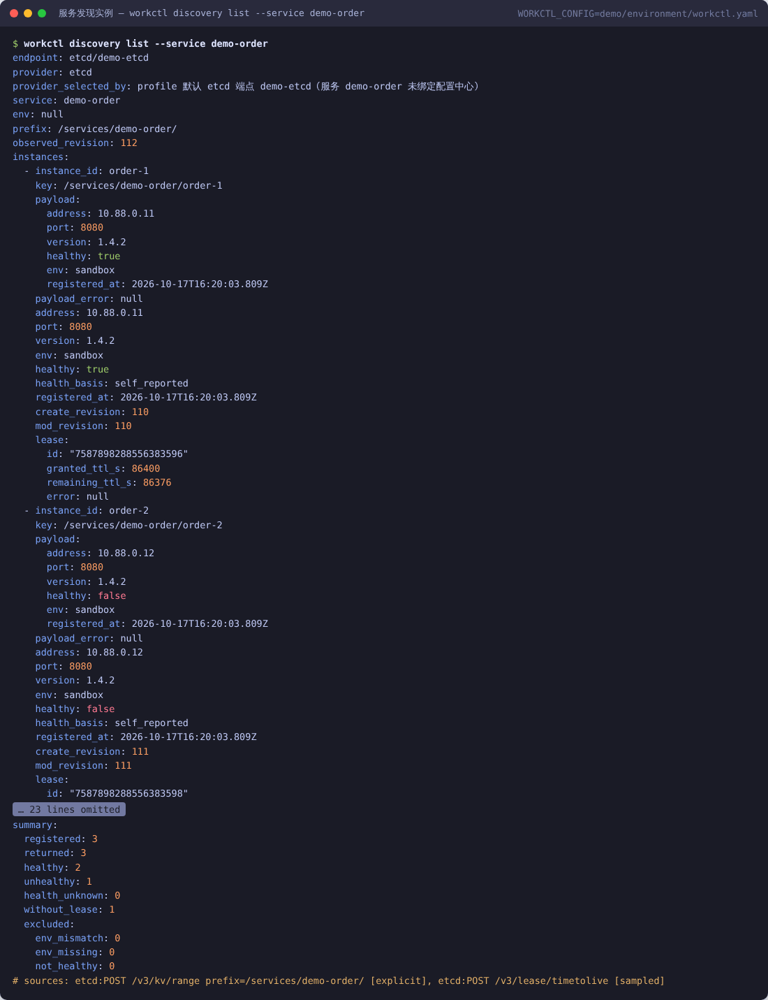

**怎么读**：每个实例有 `address`、`port`、`version`、`healthy`。`health_basis: self_reported` 说明健康状态是实例自报的，不是探测结果。`lease` 给出 `granted_ttl_s` 和 `remaining_ttl_s`。`summary` 中 `healthy: 2`、`unhealthy: 1`、`without_lease: 1`。来源里租约剩余时间标为 `[sampled]`，因为它是读取那一刻的值。

### 7.2 Nacos（demo-payment）与 Consul（demo-inventory）

```bash
workctl config get --service demo-payment --env sandbox          # 绑定到 Nacos
workctl config get --service demo-inventory --env sandbox        # 绑定到 Consul KV
workctl discovery list --service demo-payment
workctl discovery list --service demo-inventory
workctl config diff --service demo-payment --key order.timeout_ms
workctl config diff --service demo-inventory --key cache.ttl_seconds; echo "exit=$?"
```

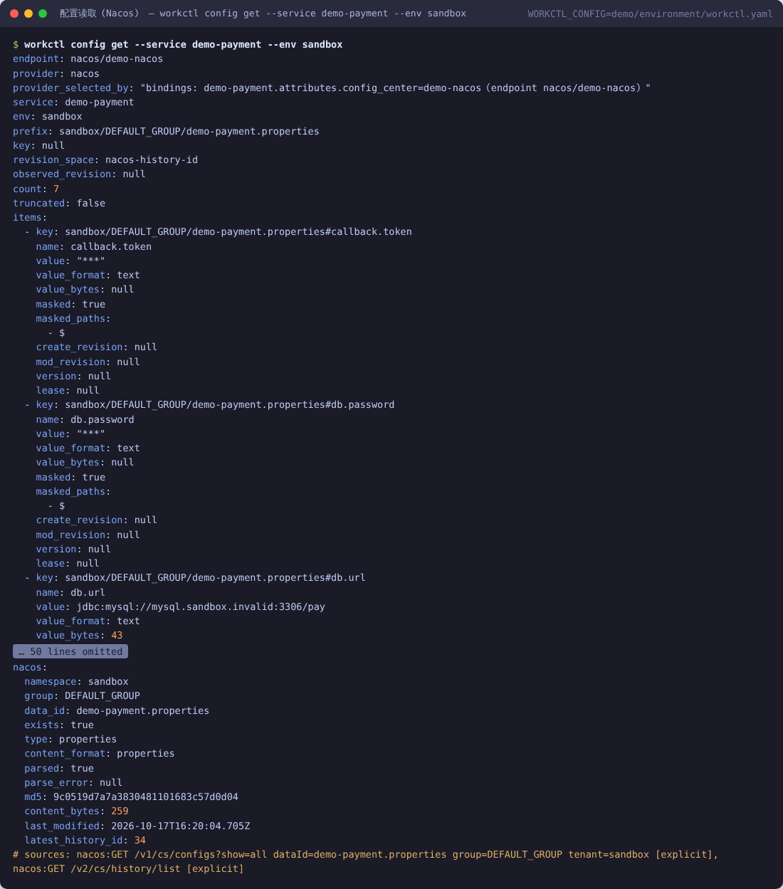

**怎么读**：命令与 7.1 相同。`provider_selected_by` 显示 demo-payment 通过绑定 `config_center=demo-nacos` 指向 `nacos/demo-nacos`，`revision_space: nacos-history-id`。`callback.token` 的 `value: "***"`、`masked: true`。末尾的 `nacos` 块给出 `data_id`、`group`、`md5` 和 `latest_history_id`。

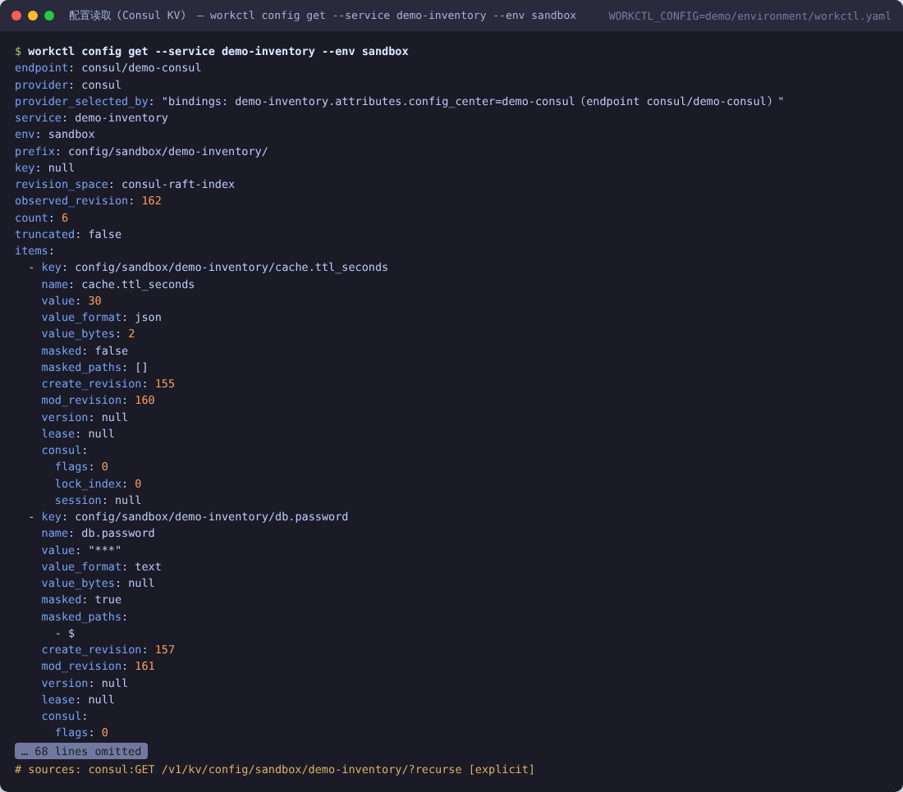

**怎么读**：demo-inventory 绑定到 `consul/demo-consul`，`revision_space: consul-raft-index`，来源 `consul:GET /v1/kv/config/sandbox/demo-inventory/?recurse`。

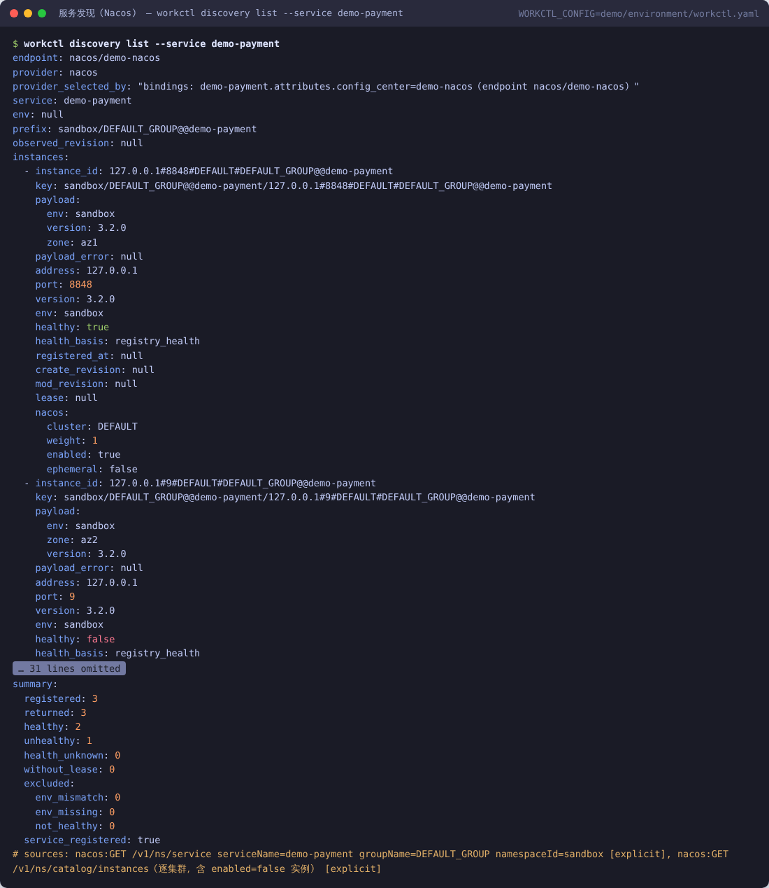

**怎么读**：输出字段与 etcd 版一致（`address`、`port`、`version`、`healthy`），差别在依据和 provider 专有字段：`health_basis: registry_health`（健康状态取自 Nacos 注册中心），`lease: null`（Nacos 没有 etcd 式租约），`nacos` 块给出 `cluster`、`weight`、`enabled`、`ephemeral`。第二个实例（端口 9）是 `healthy: false`。`summary` 为 `healthy: 2`、`unhealthy: 1`。`# sources` 注明实例列表逐集群读取，包含 `enabled=false` 的实例。

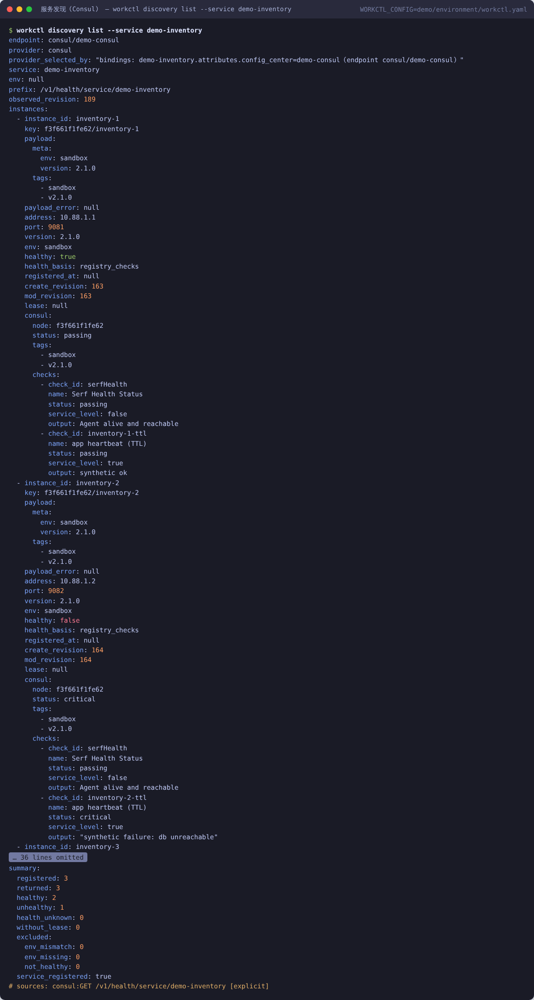

**怎么读**：`health_basis: registry_checks`，健康状态由 Consul 的检查结果决定。`consul.checks` 列出每个检查。`inventory-2` 的节点检查 `serfHealth` 是 `passing`，但服务级的 `inventory-2-ttl` 是 `critical`（`output: "synthetic failure: db unreachable"`），所以实例 `healthy: false`、`consul.status: critical`。`summary` 为 `healthy: 2`、`unhealthy: 1`。

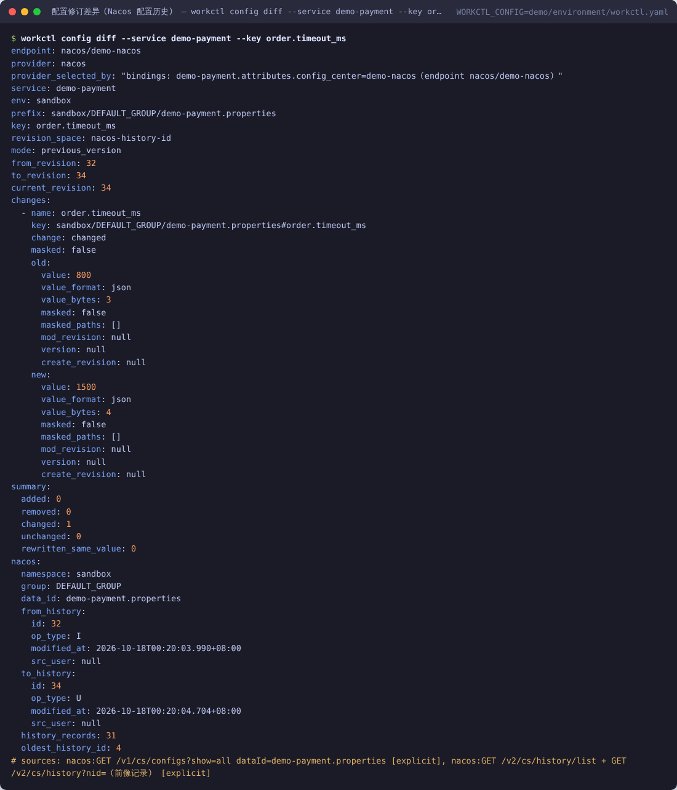

**怎么读**：Nacos 保留配置历史，`config diff` 可以给出上一版本：`order.timeout_ms` 从 `800` 变为 `1500`。`from_revision` / `to_revision` 是 Nacos 历史 ID（`revision_space: nacos-history-id`）。`nacos.from_history` / `to_history` 给出两条历史记录的 `op_type` 和 `modified_at`，`src_user: null`（操作人不可得）。`history_records` 和 `oldest_history_id` 说明能追溯的范围。

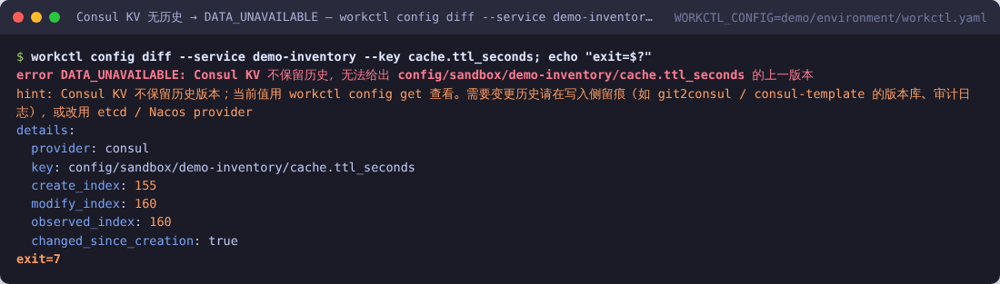

**怎么读**：Consul KV 不保留历史，所以同一条命令如实返回 `error DATA_UNAVAILABLE`，而不是编一个“无变化”。`details` 给出能确定的部分：`create_index: 155`、`modify_index: 160`、`changed_since_creation: true`，即这个键创建后改过，但看不到改之前的值。`hint` 给出替代办法（写入侧留痕，或改用 etcd / Nacos）。退出码 `exit=7`（未采集/无数据）。

---

## 8. 插件扩展

**目标**：确认插件已安装，看插件补齐的能力，以及部分结果和受限 DSL 如何表达。

```bash
workctl plugin list
workctl capability list --domain search
workctl search query --cluster demo-search --index demo-orders-all --dsl-file demo/scenarios/search/dsl/latest_across_archive.json; echo "exit=$?"
workctl search query --cluster demo-search --index demo-orders-all --dsl-file demo/scenarios/search/dsl/script_score.json; echo "exit=$?"
```

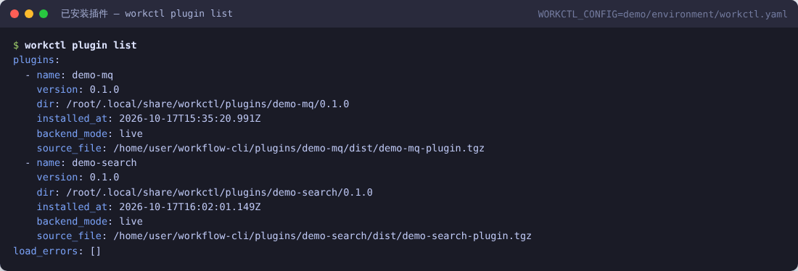

**怎么读**：已安装 `demo-mq` 和 `demo-search` 两个插件，都是 `backend_mode: live`。`source_file` 指向仓库内的插件包，`load_errors: []`。

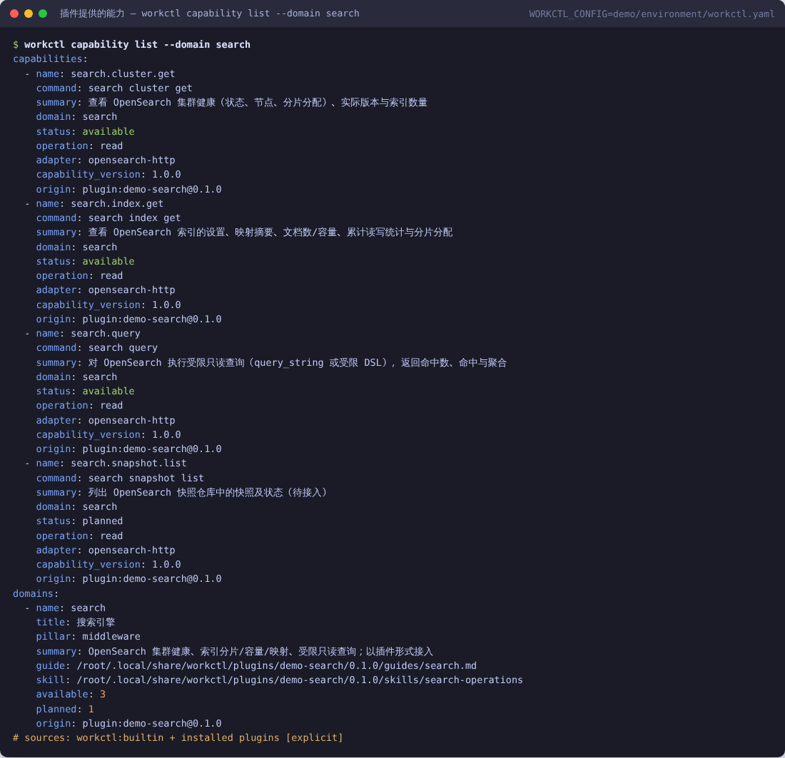

**怎么读**：`search.cluster.get`、`search.index.get`、`search.query` 是 `available`，`origin: plugin:demo-search@0.1.0`。`search.snapshot.list` 仍是 `planned`。底部 `domains` 显示 `available: 3`、`planned: 1`。

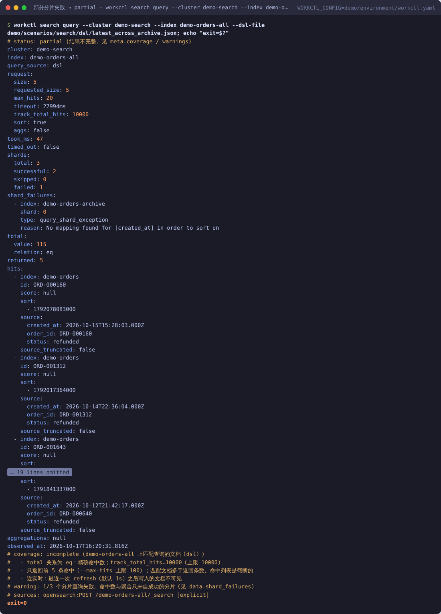

**怎么读**：第一行 `# status: partial`。`shards` 中 `total: 3`、`successful: 2`、`failed: 1`，`shard_failures` 指出 `demo-orders-archive` 分片的原因是 `No mapping found for [created_at] in order to sort on`。因此 `total.value: 115` 只来自成功的分片。`# coverage: incomplete` 和 `# warning: 1/3 个分片查询失败…` 说明了不完整的范围。默认退出码是 `exit=0`；如果要让脚本把 partial 当失败，加 `--fail-on-partial`（退出码 10）。

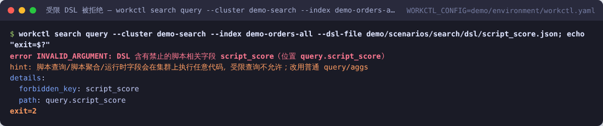

**怎么读**：DSL 中含 `script_score`，在发往集群之前就被拒绝：`error INVALID_ARGUMENT`，`details.path: query.script_score`，`hint` 说明了原因。退出码 `exit=2`（参数错误）。

---

## 9. 受控操作：计划 → 授权检查 → 执行被拒绝

**目标**：看一份操作计划包含什么，以及只读 profile 怎样挡住执行。本节全部使用只读 profile `workctl.agent.yaml`，没有执行任何操作。

```bash
export WORKCTL_CONFIG=demo/environment/workctl.agent.yaml
workctl container workload restart-plan --service demo-order --env sandbox
workctl access check --capability operation.execute
workctl --json operation execute --id <plan_id> --confirm <plan_id>; echo "exit=$?"
```

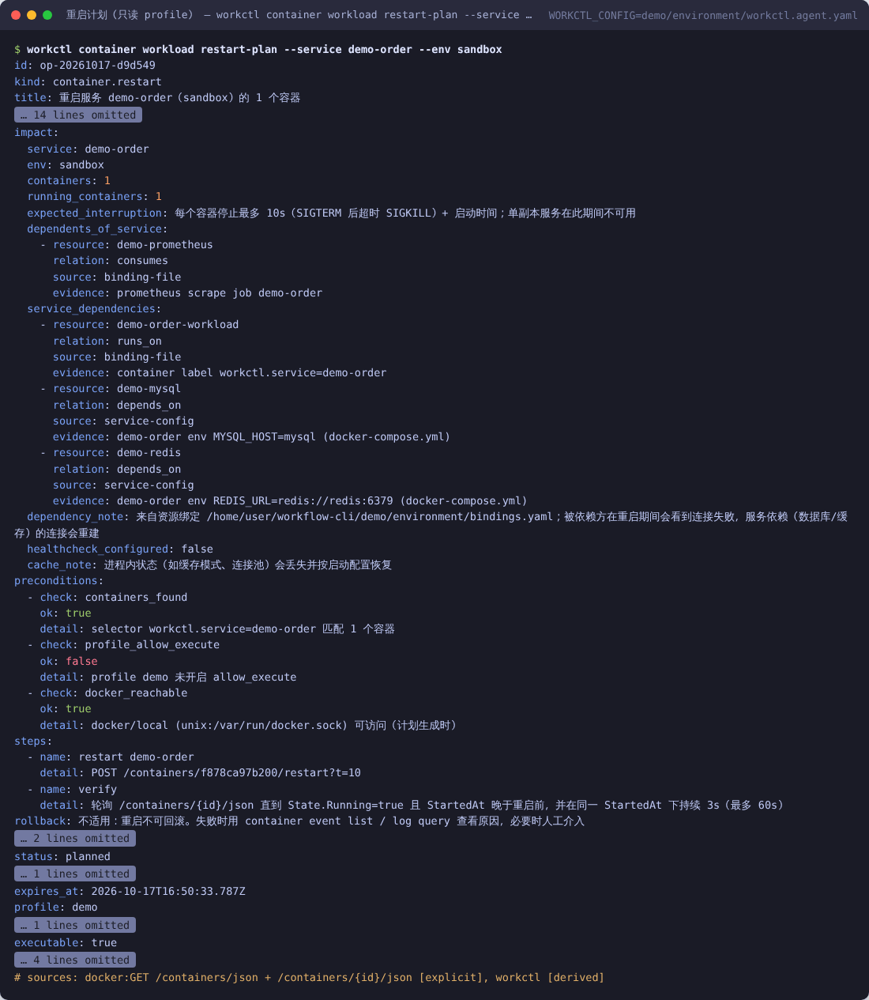

**怎么读**：计划 `id: op-20261017-d9d549`，`kind: container.restart`。`impact` 写明预计中断（单副本服务在重启期间不可用）、被依赖方和服务依赖，以及进程内状态会丢失。`preconditions` 中 `profile_allow_execute` 为 `ok: false`。`steps` 列出将调用的 Docker API 和复核方式。`rollback` 写明“不适用：重启不可回滚”。`status: planned`，`expires_at` 是计划过期时间。截图折叠了 `params`、`targets`、`history` 等字段。

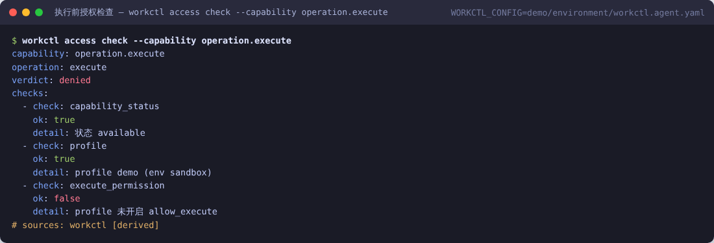

**怎么读**：`verdict: denied`，原因是 `execute_permission` 为 `ok: false`（profile 未开启 allow_execute）。

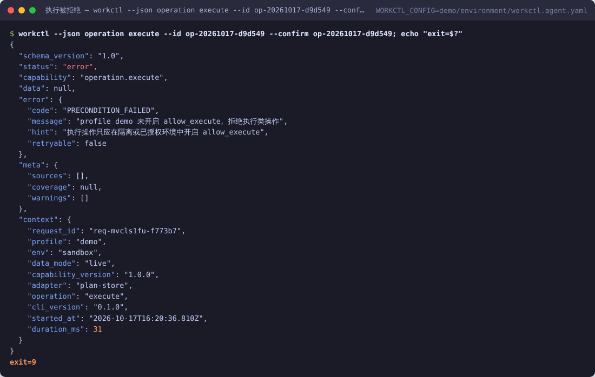

**怎么读**：即使 `--confirm` 填了正确的计划 ID，执行仍被引擎拒绝：`error.code: PRECONDITION_FAILED`，`message` 为 “profile demo 未开启 allow_execute，拒绝执行类操作”，`exit=9`。生成器运行这一步之前，会先用 `access check` 确认该 profile 会拒绝执行，否则跳过这一步。

---

## 10. 多 provider：同一命令，不同后端

**目标**：同一条命令通过资源绑定或 profile 切换到 Kubernetes、Airflow 3 和 Loki，输出用同一契约。

```bash
WORKCTL_CONFIG=demo/environment/k8s/workctl.k8s.yaml workctl container workload get --service demo-order --env sandbox
WORKCTL_CONFIG=demo/environment/workctl.af3.yaml   workctl --json offline run list --workflow demo-daily-orders --data-date 2026-10-16 --timezone Asia/Shanghai
WORKCTL_CONFIG=demo/environment/workctl.loki.yaml  workctl log query --service demo-order --env sandbox --window 6h --contains "cache mode changed" --limit 2
```

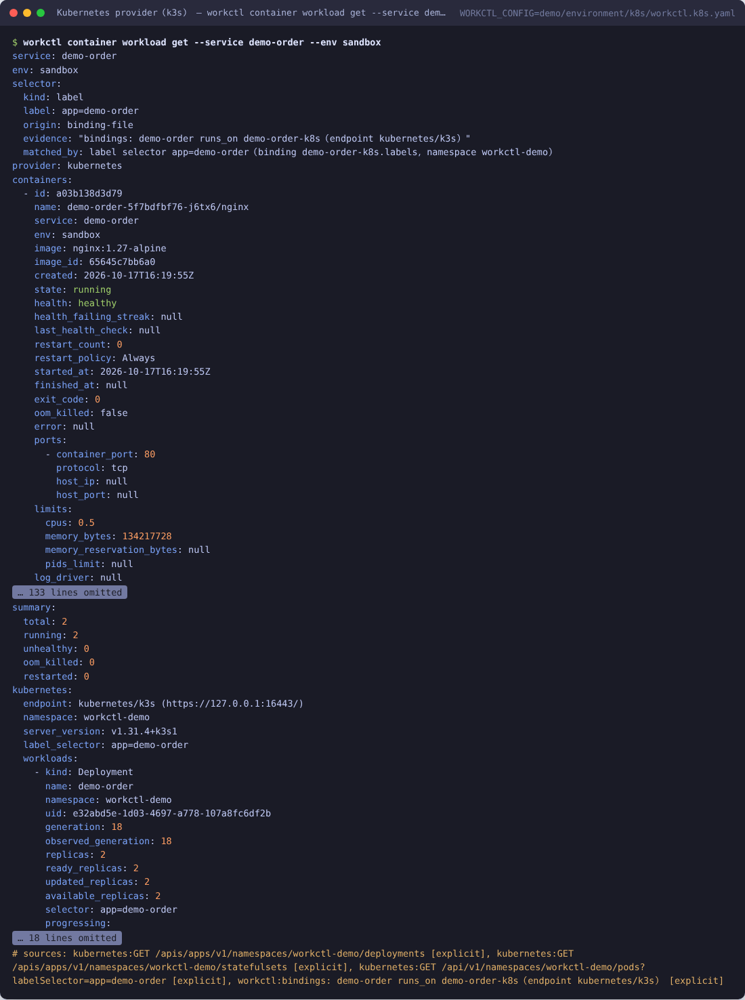

**怎么读**：这条命令和第 4 节的 Docker 版本完全相同，这里 `provider: kubernetes`，selector 换成 `app=demo-order`（namespace `workctl-demo`）。容器条目的字段与 Docker 版一致（`state`、`health`、`restart_count`、`limits` 等）。另外多了 `kubernetes` 块：`server_version: v1.31.4+k3s1`，Deployment 的 `replicas: 2`、`ready_replicas: 2`。`summary` 显示 `total: 2`、`running: 2`。

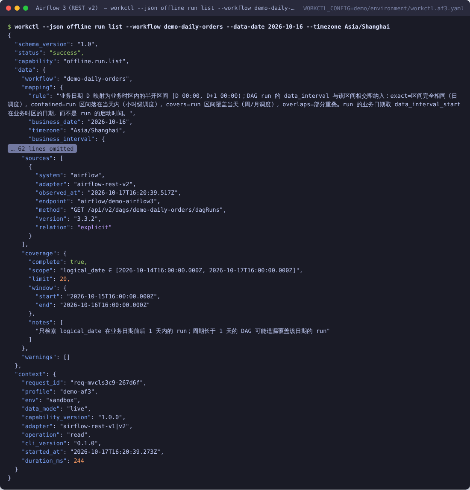

**怎么读**：与第 6 节同一个能力 `offline.run.list`，这里 `meta.sources[0]` 是 `adapter: airflow-rest-v2`、`method: GET /api/v2/…`、`version: 3.3.2`；第 6 节的 Airflow 2 是 `airflow-rest-v1`、`2.10.5`。`context.profile` 为 `demo-af3`。截图折叠了 `data` 的中间部分，同一个 run 的完整内容见 `.txt`。

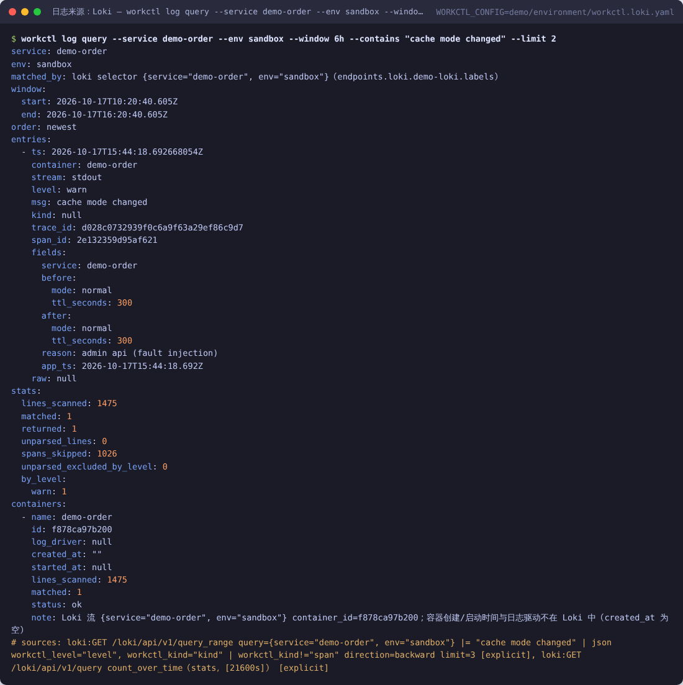

**怎么读**：与第 4 节的日志查询相比，命中的是同一条日志（同一时间戳和 `trace_id`），`stats` 也相同（扫描 1475 行、命中 1 行）。不同的地方：`matched_by` 是 Loki 选择器 `{service="demo-order", env="sandbox"}`；`containers[].log_driver: null`，`note` 说明容器创建/启动时间不在 Loki 中；`# sources` 是 `loki:GET /loki/api/v1/query_range`。

---

## 11. Agent 接入

**目标**：用 MCP 暴露同一套能力，并查看一次 Agent 实际运行的摘要。

```bash
WORKCTL_CONFIG=demo/environment/workctl.agent.yaml node docs/tutorial/mcp-tools-list.mjs
```

[`mcp-tools-list.mjs`](mcp-tools-list.mjs) 通过 stdio 启动 `workctl mcp serve`，依次发送 JSON-RPC `initialize`、`tools/list` 和一次只读的 `tools/call`，再打印摘要。

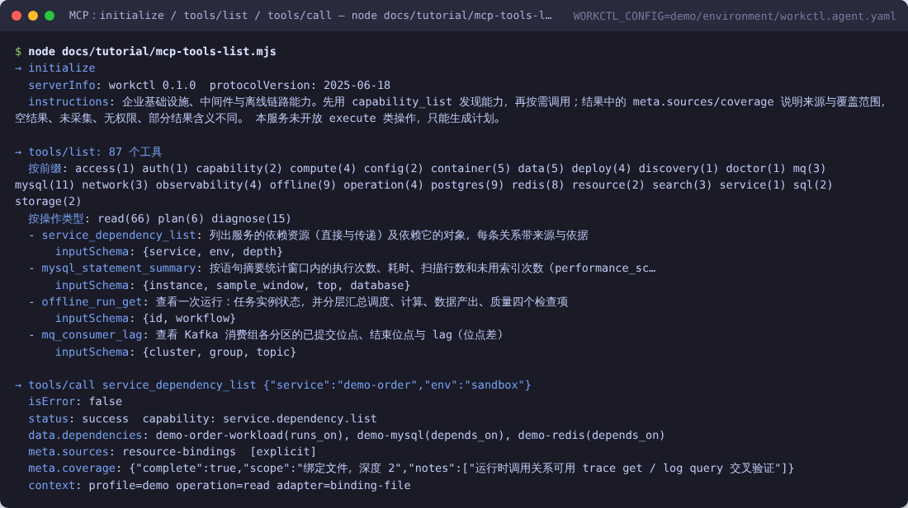

**怎么读**：`initialize` 返回 `serverInfo: workctl 0.1.0`，`instructions` 里写明“本服务未开放 execute 类操作，只能生成计划”。`tools/list` 有 87 个工具，按操作类型只有 `read`、`plan`、`diagnose`，没有 `execute`。每个工具的 `inputSchema` 与 CLI 参数对应（例如 `mysql_statement_summary` 有 `{instance, sample_window, top, database}`）。`tools/call service_dependency_list` 返回的信封与第 4 节 CLI 的结果一致：同样的三条依赖、`meta.sources: resource-bindings [explicit]` 和 `coverage`。

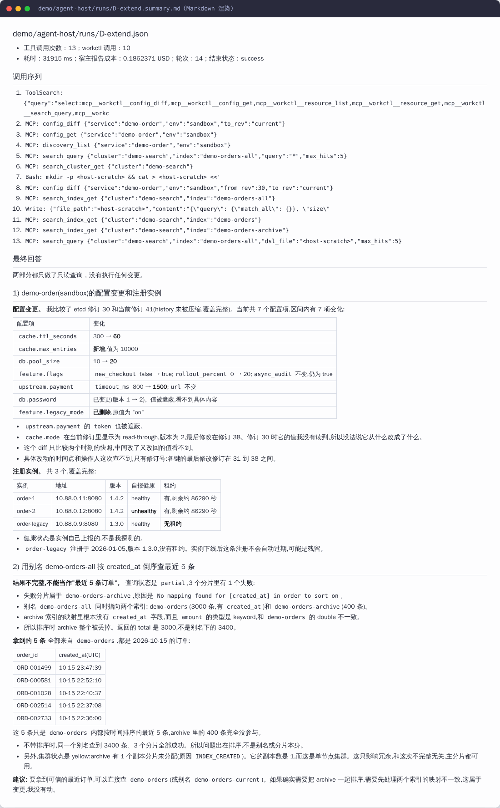

**怎么读**：这是 [demo/agent-host/runs/D-extend.summary.md](../../demo/agent-host/runs/D-extend.summary.md) 渲染成页面后的截图，不是本次重新运行的结果。记录显示：13 次工具调用、10 次 workctl 调用、31.9 s、宿主报告成本 0.186 USD。调用序列全部是 MCP 只读工具。最终回答把配置变更（遮蔽值只说“已变更”）、实例的自报健康与无租约，以及搜索结果 `partial` 的原因（archive 分片缺少 `created_at` 映射）分开说明，并写明“没有执行任何变更”。该次运行时索引数据与本教程第 8 节截图时不同（运行记录中 total 为 3000，第 8 节截图为 115），以各自的输出为准。

---

## 12. 数据库：PostgreSQL

**目标**：查看实例概况；在真实负载下做窗口采样，找出最耗时的语句；用执行计划确认原因；查看锁等待。账号是只读的 `workctl_ro`。

```bash
workctl pg instance get --instance demo-postgres
node demo/scenarios/postgres/scenario.mjs load --seconds 15 >/dev/null 2>&1 &
workctl --timeout 30s pg statement summary --sample-window 10s --database demo_orders --top 2; wait
workctl pg query explain --sql "SELECT id, status, amount, created_at FROM orders WHERE customer_id = 42 ORDER BY created_at DESC LIMIT 20"
workctl pg lock list
```

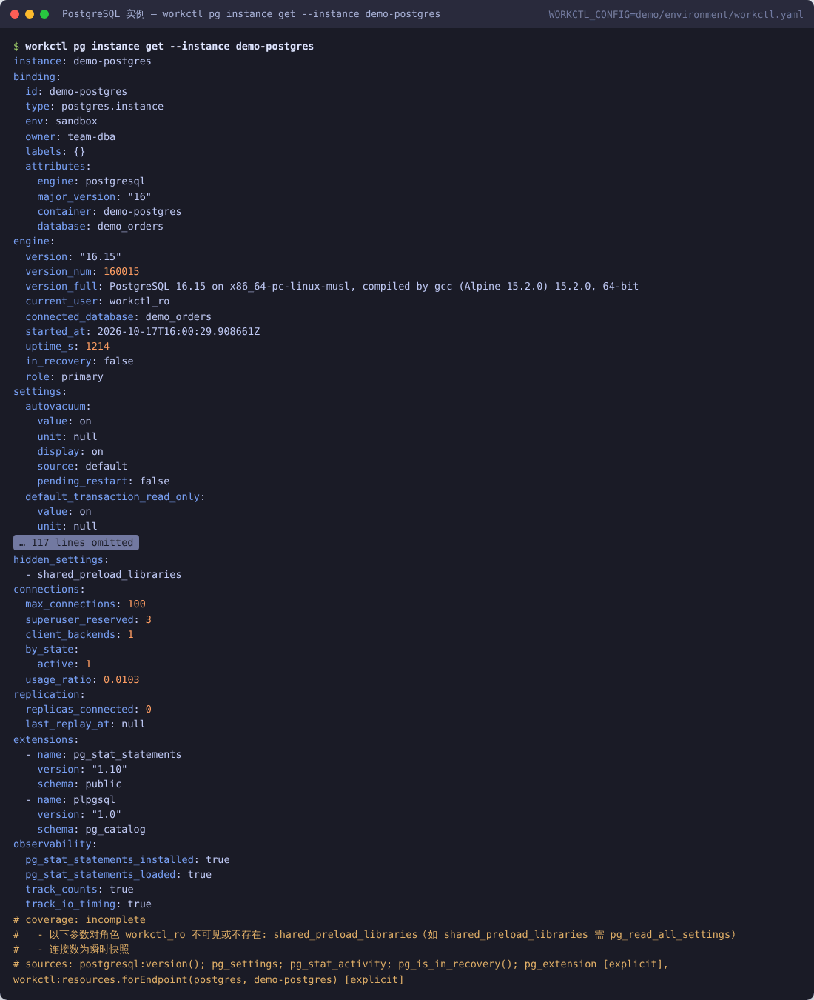

**怎么读**：`engine.version: "16.15"`，`current_user: workctl_ro`，`role: primary`。`settings` 中每项有 `value` 和 `source`（截图折叠了大部分）。`hidden_settings` 列出 `shared_preload_libraries`；`# coverage: incomplete` 说明这个参数对 `workctl_ro` 不可见，连接数是瞬时快照。

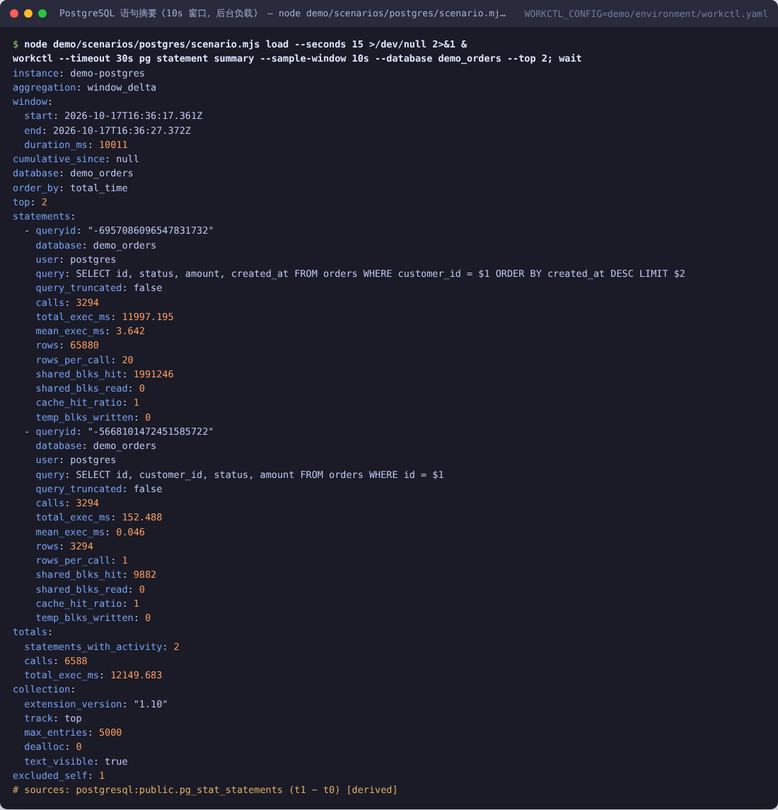

**怎么读**：场景脚本在后台反复执行两条查询，同时 workctl 做 10 秒窗口采样（`aggregation: window_delta`，`duration_ms: 10011`）。

- 按 `total_time` 排序，第一条是 `WHERE customer_id = $1 ORDER BY created_at DESC LIMIT $2`：窗口内 `calls: 3294`、`total_exec_ms: 11997.195`、`mean_exec_ms: 3.642`。`rows_per_call: 20` 很低，`shared_blks_hit: 1991246` 却很高。
- 第二条主键查询 `WHERE id = $1` 调用次数相同，`mean_exec_ms: 0.046`。
- `excluded_self: 1` 表示 workctl 自己的采样语句已排除。`collection` 给出 `pg_stat_statements` 的版本和 `dealloc: 0`（窗口内没有条目被挤出）。来源 `public.pg_stat_statements (t1 − t0) [derived]`。

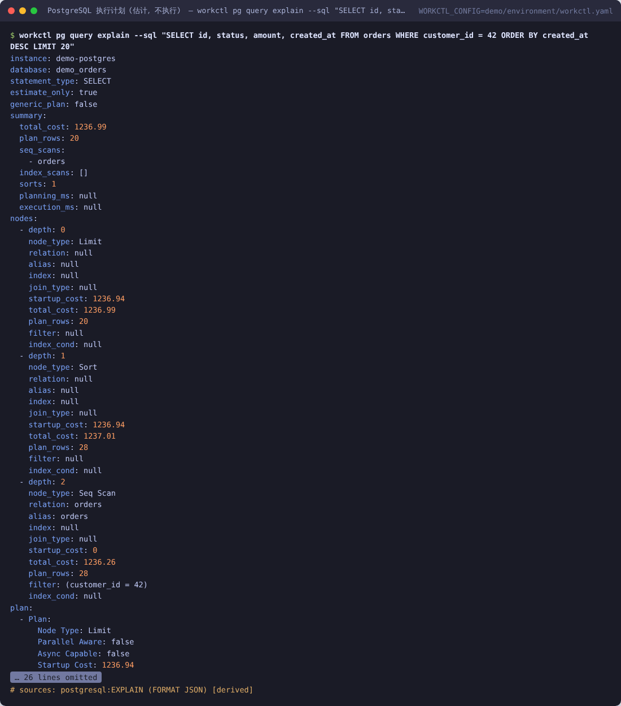

**怎么读**：`estimate_only: true`，`planning_ms` / `execution_ms` 为 `null`，表示只做 EXPLAIN，没有执行语句。`summary.seq_scans: [orders]`、`index_scans: []`、`sorts: 1`。`nodes` 自上而下是 `Limit` → `Sort` → `Seq Scan`（`relation: orders`，`filter: (customer_id = 42)`），即全表扫描后再排序。这与上一张图中该语句 `shared_blks_hit` 高、`rows_per_call` 低一致。`plan` 是 `EXPLAIN (FORMAT JSON)` 的原始结构（截图中折叠）。加索引属于变更，这里不做。

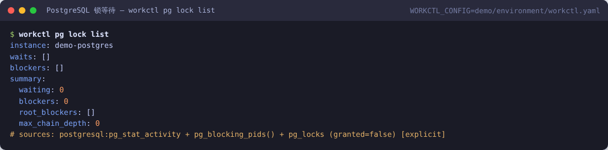

**怎么读**：截图时没有锁等待：`waits: []`、`blockers: []`，`summary.waiting: 0`。来源标明查询了 `pg_stat_activity + pg_blocking_pids() + pg_locks (granted=false)`，`[explicit]`。这是“查过、为空”，不是“没查”。

---

## 13. 部署系统：Kubernetes 与 Jenkins

**目标**：查看发布历史，定位失败的发布及其日志，生成回滚计划（不执行）。同一组 `deploy` 命令按资源绑定选择 provider：k3s profile 下是 Kubernetes Deployment 修订，docker profile 下是 Jenkins 部署 job。

```bash
WORKCTL_CONFIG=demo/environment/k8s/workctl.k8s.yaml workctl deploy release list --service demo-order --env sandbox --limit 3
workctl deploy release list --service demo-order --env sandbox                 # docker profile → Jenkins
workctl deploy release get --service demo-order --env sandbox --id 3           # 失败的 v1.4.2-bad 构建
workctl deploy rollback plan --service demo-order --env sandbox                # 只生成计划
```

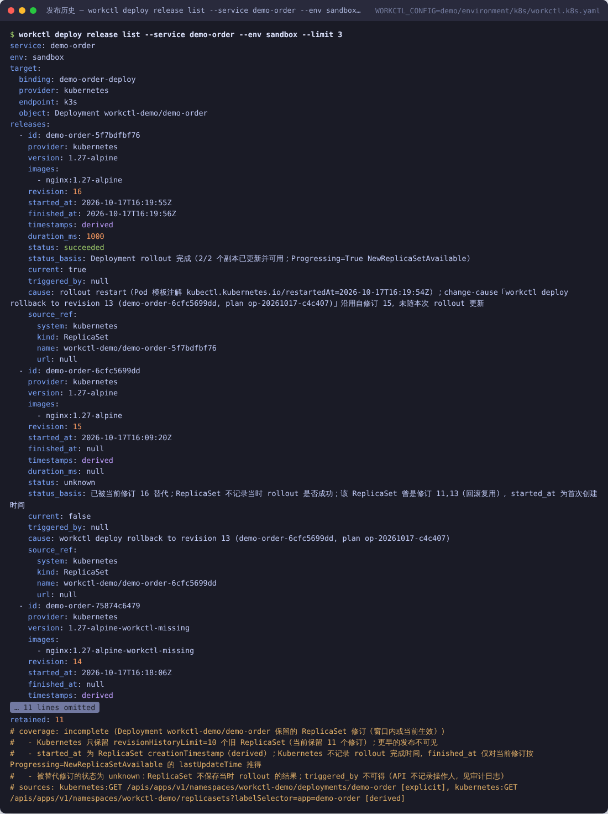

**怎么读**：`target.provider: kubernetes`，对象是 `Deployment workctl-demo/demo-order`。当前修订 `current: true`、`status: succeeded`，`status_basis` 写明判断依据。被替代的修订是 `status: unknown`，因为 ReplicaSet 不保存当时 rollout 的结果。`# coverage: incomplete` 说明只保留 `revisionHistoryLimit` 个修订、`started_at` 是推导值、API 不记录操作人。截图里的修订都是同一环境中其他测试做的滚动重启和回滚。

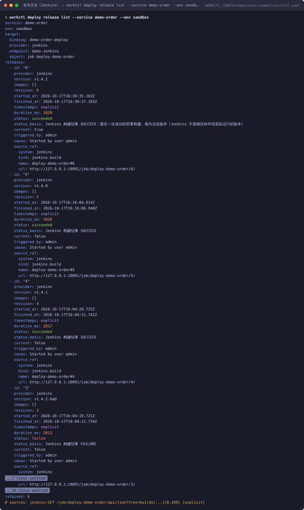

**怎么读**：`target.provider: jenkins`，对象是 `job deploy-demo-order`。每个构建是一条发布：`version` 取自构建参数，`timestamps: explicit`（Jenkins 记录了开始和结束时间），`triggered_by: admin`。`#6`（v1.4.1）是 `current: true`；`status_basis` 写明这只是“最近一次成功的部署构建”，Jenkins 并不观测目标环境实际运行的版本。`#3` 是 `v1.4.2-bad`，`status: failed`（`Jenkins 构建结果 FAILURE`）。seed 脚本只创建 `#1`–`#4`；`#5`、`#6` 是之后在同一环境中触发的构建。

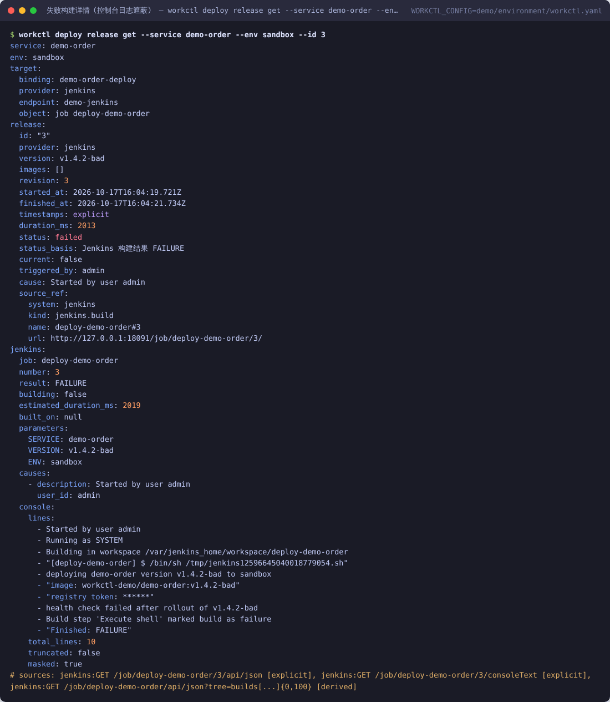

**怎么读**：`release` 与列表中的字段相同。`jenkins` 块给出 `result: FAILURE`、构建参数（`VERSION: v1.4.2-bad`）、触发原因，以及控制台日志末尾 `console.lines`：其中 `health check failed after rollout of v1.4.2-bad` 是失败原因。`"registry token: ******"` 被遮蔽，`masked: true`。生成器另外检查了原始输出中没有出现该 token 的明文。`total_lines: 10`、`truncated: false` 表示日志全部返回。来源包含 `GET /job/deploy-demo-order/3/consoleText`。

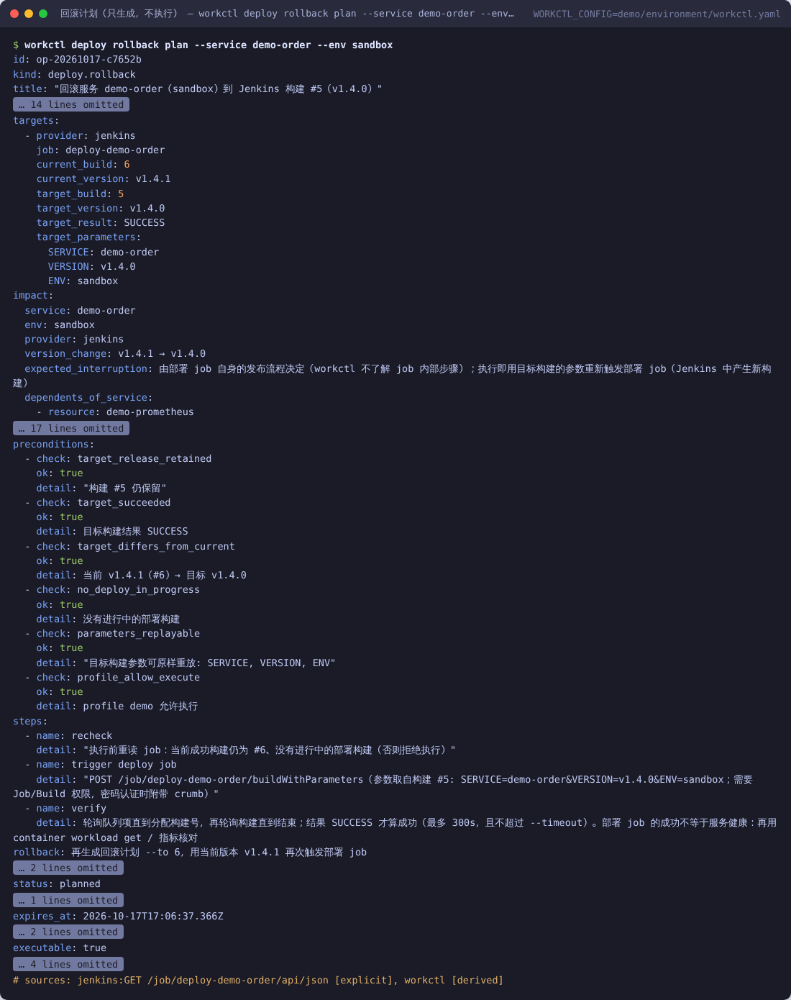

**怎么读**：没有给 `--to` 时，计划选“上一个不同版本的成功构建”：`#6 v1.4.1 → #5 v1.4.0`（`targets`、`impact.version_change`）。`impact.expected_interruption` 说明 workctl 不了解 job 内部步骤，执行就是用目标构建的参数重新触发部署 job。`preconditions` 逐项列出目标仍保留、目标成功、与当前不同、没有进行中的部署、参数可重放、profile 允许执行。`steps` 中的 `verify` 写明“部署 job 的成功不等于服务健康”。`rollback` 写明如何反向回滚。计划 `status: planned`，本教程没有执行它；执行需要 `operation execute --id <id> --confirm <id>`，且 profile 开启 `allow_execute`。

---

## 重新生成

```bash
# 仓库根目录；需要演示环境（demo/environment/up.sh）和场景数据，k8s / Airflow 3 步骤另需 k3s-up.sh / offline3-up.sh
# 第 12 节的 pg statement summary 会在后台运行 demo/scenarios/postgres/scenario.mjs load（只读 SELECT）
node scripts/tutorial-screenshots.mjs                      # 全部步骤，约 1 分钟
node scripts/tutorial-screenshots.mjs --only doctor,mysql-explain
node scripts/tutorial-screenshots.mjs --text-only          # 只运行命令、写 .txt，不截图
node scripts/tutorial-screenshots.mjs --out /tmp/tutorial   # 输出到其他目录，试跑时不覆盖这里的截图
```

- 截图用 Playwright + Chromium：先找本地 `playwright`，找不到再用全局安装的；浏览器取 `PLAYWRIGHT_BROWSERS_PATH`（默认 `/opt/pw-browsers`）下的 Chromium。如果有 python3 + Pillow，生成器会把 PNG 量化为 256 色调色板，体积约减半。
- 写文件前，生成器会扫描 `demo/environment/.runtime/secrets/*` 以及 k8s token / kubeconfig 中的凭据值，另外还检查一个本应被遮蔽的字符串（Jenkins 部署 job 打印的 registry token 默认值）。输出中出现任何一个值，这一步就失败，也不写文件。
- 步骤清单在生成器顶部的 `STEPS` 中。每步可以设置 `config`、截断规则（`maxLines` / `tail` / `keepKeys` / `blockMax`）、`capture`（从输出取值给后续步骤，如失败构建号）和 `optional`；输出中出现 `unknown command` 的步骤会被跳过。第 12、13 节和 7.2 的新步骤追加在清单末尾（编号 41–50），已有图片编号保持不变。
- 重新生成后数值（时间戳、修订号、计数）会变化，本文“怎么读”中的具体数值对应本次截图。
